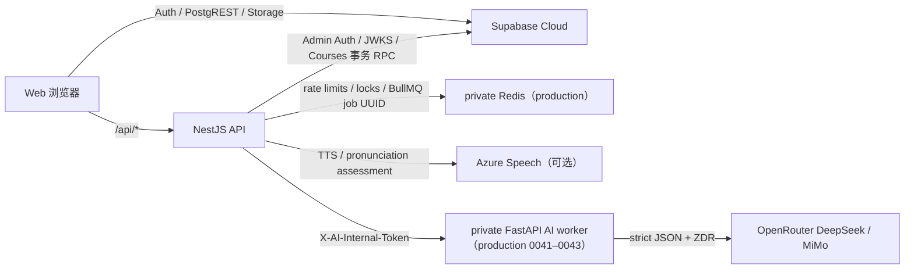

# API 文档

> **本文内容：** 记录当前 NestJS 公网 API、生产 0041–0043 FastAPI 内部接口，以及浏览器直接使用的 Supabase Auth/PostgREST/Storage 数据面；同时指出尚未实现的目标 API。
> **作用：** 为前后端联调、客户端开发、自动化测试、安全评审和接口演进提供明确契约，避免把架构蓝图中的接口误认为已经可用。  
> **何时更新：** 新增/删除/变更路由、请求/响应/状态码、认证授权、数据 schema、Supabase 访问方式、错误码或 API 版本策略时，与实现同一提交更新。

## 1. 当前接口边界



- 生产 Web/API 同源基址：`https://nalanda.online`；本文示例默认本地 `http://localhost:3000`。
- NestJS 全局前缀：`/api`。
- FastAPI 默认本地基址：`http://localhost:8000`，生产只允许 compose 私网访问；0041 由 BullMQ consumer 通过内部 token 调用，生产 0043 已部署该链路。
- 当前没有 OpenAPI 文件、API 版本号、请求 ID 或通用分页规范。Nest 全局错误已统一为 `{ code, message, fieldErrors?, currentRevision?, retryAfterSeconds? }`。生产 0039–0040 已启用全局 Redis 限流。
- NestJS 跨域许可来自 `CORS_ALLOWED_ORIGINS`，未设置时复用 `PUBLIC_ORIGIN`；生产两者都缺失时不返回跨域许可，同源 nginx `/api` 不受影响，且当前不启用 credential cookie。

## 2. 认证约定

### 2.1 浏览器登录链路

1. 注册时浏览器调用 `POST /api/auth/register`；API 用 service-role 调 Supabase Admin Auth 创建已确认用户。
2. 浏览器随后直接调用 `supabase.auth.signInWithPassword` 获取 Supabase session。
3. 访问受保护 NestJS 接口时发送：

```http
Authorization: Bearer <supabase-access-token>
```

4. API 优先从 `<SUPABASE_URL>/auth/v1/.well-known/jwks.json` 获取公钥，只接受 ES256/RS256，并校验 issuer、`audience=authenticated`、UUID `sub` 与 `role=authenticated`；旧 HS256 项目可用 `SUPABASE_JWT_SECRET` 回退，声明校验相同。

Courses、会话、复习、Profile 学习聚合、语音、分享克隆、市场发布/克隆/举报都是 bearer 接口；公共分享预览和市场列表除外。Web 的 Materials、社区、普通计划、旧 Profile、反馈和通知仍主要通过 `supabase-js` 直连。

### 2.2 错误格式

NestJS 全局错误格式：

```json
{
  "code": "INVALID_COURSE",
  "message": "课程内容校验失败",
  "fieldErrors": { "units.0.words.1.term": "同一单元内不能重复" }
}
```

`fieldErrors` 可选；未知 4xx 映射为 `INVALID_REQUEST`，413 为 `PAYLOAD_TOO_LARGE`，未知 5xx 为 `INTERNAL_ERROR`。常见状态：400 参数/契约，401 token，403 owner/管理员，404 不存在或功能隐藏，409 冲突，413 multipart 上限，429 配额，502 供应商，503 feature flag/依赖不可用。内部 FastAPI 使用 Pydantic `422 detail` 和稳定 AI 错误码，由 NestJS 转换后才可返回浏览器。

### 2.3 生产 0039–0040：通用限流

Nest guard 完成鉴权后由全局 interceptor 应用原子 Redis 滑动窗口；nginx 另叠加 API 20 次/秒 burst 40、注册 1 次/秒 burst 3。键只含 user UUID 或 `HMAC-SHA256(IP/email)`，不把原始 IP/email 写入 Redis、Postgres 或日志。

| 路由组 | 规则 |
|---|---|
| 注册 | IP 5/15 分钟 + 规范化 email 3/小时 |
| 所有认证 API | user 300/分钟 |
| Courses 写入（含语音/评判/克隆/举报）和会触发 TTS 队列的 session/audio GET | 上述规则 + user 120/分钟 + IP 60/10 秒；供应商持久配额继续叠加 |
| 公开 Course Market/share GET | IP 120/分钟 |

拒绝返回 429、`Retry-After`、`RateLimit-Limit/Remaining/Reset/Policy`：

```json
{ "code": "RATE_LIMITED", "message": "Too many requests", "retryAfterSeconds": 42 }
```

Redis 故障时注册、写入、公开 Courses 读取、克隆/举报和成本路径返回 `503 RATE_LIMIT_UNAVAILABLE`；已认证私有只读 fail-open 并写 `rate_limit_degraded` 结构化日志。Courses outbox 保留原 attempt UUID 并等到 `retryAfterSeconds` 后串行重试；音频 manifest 轮询退避，不把 429 标成音频生成失败。

nginx 自身触发的 429 也返回相同 JSON、`Retry-After` 和 `RateLimit-Limit/Remaining/Reset`；Nest 上游的 429 不被拦截，所以精确的 user/window headers 保持原样。HMAC 只覆盖应用审计数据，不改变 nginx 既有基础访问日志的保留策略。

## 3. NestJS API（当前实现）

### `GET /api/health`

认证：无。  
实现：`apps/api/src/health/health.controller.ts`。

响应 `200`：

```json
{
  "status": "ok",
  "service": "nalanda-api",
  "time": "2026-07-10T00:00:00.000Z",
  "deps": {
    "redis": "ok",
    "ai": "unset",
    "supabase": "ok"
  }
}
```

语义：返回 200 前访问 Supabase JWKS 与 `profiles?select=id&limit=0`，并校验 HMAC secret、执行真实 Redis PING。Supabase 或 Redis 任一不可用都返回 503，只暴露依赖状态；AI 仍只显示 `configured/unset`。Storage、注册写入、RLS 和完整用户路径不在本 endpoint 内验证。

失败响应 `503`：

```json
{
  "status": "error",
  "service": "nalanda-api",
  "time": "2026-07-10T00:00:00.000Z",
  "deps": { "redis": "unavailable", "ai": "unset", "supabase": "unavailable" }
}
```

示例：

```bash
curl -fsS http://localhost:3000/api/health
```

### `POST /api/auth/register`

认证：无。  
Content-Type：`application/json`。  
实现：`apps/api/src/auth/auth.controller.ts`。

请求：

```json
{
  "email": "developer@example.com",
  "password": "at-least-6-characters"
}
```

处理规则：email 去首尾空白并转小写，使用简单邮箱正则；password 最少 6 字符。成功时通过 Supabase Admin API 创建 `email_confirm=true` 的用户。

| HTTP | `code` | 含义 |
|---:|---|---|
| 200 | — | `{ "ok": true }`；只代表创建成功，不返回 session |
| 400 | `INVALID_EMAIL` | 邮箱格式不通过当前正则 |
| 400 | `WEAK_PASSWORD` | 密码少于 6 字符 |
| 400 | `REGISTER_FAILED` | 未归类的 Supabase 注册失败 |
| 409 | `EMAIL_TAKEN` | 邮箱已存在；由状态码或上游文本启发式识别 |
| 500 | `SERVER_MISCONFIG` | API 缺 `SUPABASE_URL` 或 service-role key |
| 502 | `UPSTREAM_UNREACHABLE` | API 无法访问 Supabase Auth |
| 429 | `RATE_LIMITED` | 限流窗口已满；按 `Retry-After` 重试 |
| 503 | `RATE_LIMIT_UNAVAILABLE` | Redis 不可用，注册 fail-closed |

示例：

```bash
curl -i http://localhost:3000/api/auth/register \
  -H 'Content-Type: application/json' \
  --data '{"email":"developer@example.com","password":"change-me"}'
```

此接口会创建真实账号，不应作为无清理逻辑的普通 smoke test，也不能对生产反复执行。生产应用有 IP+email 双层 Redis 限流与 HMAC 审计；仍没有验证码、邮箱所有权证明或密码强度扩展规则。

### `GET /api/me`

认证：Supabase bearer token。  
实现：`apps/api/src/me/me.controller.ts` 和 `apps/api/src/auth/supabase.guard.ts`。

成功 `200`：

```json
{
  "user": {
    "id": "00000000-0000-0000-0000-000000000000",
    "email": "developer@example.com",
    "role": "authenticated"
  }
}
```

`id` 来自 JWT `sub`；`email`、`role` 可能不存在，因此客户端必须按可选字段处理。该接口不会查询 `profiles`。

失败 `401`：无 token 时 message 为 `Missing bearer token`；验签失败或没有 `sub` 时为 `Invalid token`。

```bash
curl -fsS http://localhost:3000/api/me \
  -H "Authorization: Bearer $SUPABASE_ACCESS_TOKEN"
```

此处 `$SUPABASE_ACCESS_TOKEN` 指用户登录 access token，不是数据库迁移使用的 Supabase Personal Access Token；两者不能混用。

### 生产 0039–0040：Points 管理接口

三条路由都要求 Supabase bearer token，随后校验 `MODERATION_ADMIN_USER_IDS`；兼容期仅在新变量为空时回退 `COURSE_MARKET_ADMIN_USER_IDS`。无管理员 UI，普通用户与匿名请求不得读取信号或调用审核事务。

| 方法 | 路径 | 请求/查询 | 成功响应 |
|---|---|---|---|
| GET | `/api/admin/points/abuse-signals?status=pending&limit=50` | status=`pending/reviewing/dismissed/escalated`，limit 1–100 | 脱敏 `PointAbuseSignal[]`，不返回内部 fingerprint |
| PATCH | `/api/admin/points/abuse-signals/:id` | `{status:"reviewing|dismissed|escalated",reviewNote?,caseReference?}` | 更新后的 signal；保留 reviewer/time |
| POST | `/api/admin/points/moderation-actions` | `ModeratePointRewardsRequest` | `PointModerationResult` |

审核请求示例：

```json
{
  "action": "suppress",
  "targetType": "post",
  "targetKey": "00000000-0000-4000-8000-000000000000",
  "reason": "Confirmed coordinated engagement",
  "caseReference": "CASE-2026-001"
}
```

`targetType=post` 会在数据库内解析根内容 key，并覆盖锚定该根的原创、转发、点赞和评论奖励；只冲正历史实际获得金额。`restore` 不补发日上限为零的 claim，也不恢复已删除来源。每次操作追加 `point_moderation_actions`，理由必填。PATCH 审核经 service-only `review_point_abuse_signal` 写入数据库时间和 reviewer；API service-role 对 claim、signal、moderation action 都只有 SELECT，不能绕过受控 RPC 直接改写。

## 4. Courses API（功能迁移 0011–0038，生产总 history 到 0043）

所有请求/响应使用 `@nalanda/types` 的 camelCase；API 内部显式转换 PostgreSQL snake_case。除标记“公开”外都需要 Supabase bearer token。`FEATURE_LEARNING_COURSES_ENABLED` 是总开关，分享、市场和语音另有子开关；生产未显式开启时分别返回 503/404，不应据此回退为前端 mock。

0019–0020 契约增加拼写限时与 OpenRouter 语义翻译前测，已于 2026-07-28 通过生产 migration history、不可变应用 release、真实供应商和候选 API gate。0021–0022 不改变 HTTP 请求/响应结构，只让七参数权威答题 RPC 对用户答案与课程原始 `term` 执行和 Web 相同的 NFKC、Unicode 空白/标点变体及 ASCII case 归一化，并已于 2026-07-31 受保护发布。限时本身由 Web 执行；服务器仍以 immutable attempt 决定 retry pool、revision、进度和奖励。

0023–0024 继续保持 HTTP 契约不变，但把仅有标点遗漏、替换或增加的答案判为正确；字母、数字、词序与无标点参与的词间空格错误仍判错。该行为已于 2026-07-31 通过独立 plan/apply 发布到生产。

0025–0028 增加显式取消会话、拼写轮末确认、考试模式与真实 provider 配额预留；已于 2026-08-01 通过独立只读 plan `30706279006` 和受保护 apply/deploy `30706731292` 发布到生产，下表新增端点已在线。

### 4.1 课程内容

| 方法 | 路径 | 请求 | 成功响应 |
|---|---|---|---|
| GET | `/api/learning-courses` | — | `LearningCourseSummary[]`，按 `updatedAt` 倒序 |
| POST | `/api/learning-courses` | `LearningCourseInput` | `LearningCourseDetail`，整课单事务创建 |
| GET | `/api/learning-courses/:id` | — | owner 的 `LearningCourseDetail` |
| PUT | `/api/learning-courses/:id` | `LearningCourseInput`；路径 ID 覆盖 body ID | 更新后的 `LearningCourseDetail`；增删单元/词或修改词内容会终止旧队列，改名、排序、移动不终止 |
| PATCH | `/api/learning-courses/:id` | `{ "title": "..." }` | 改名后的 detail；不重置学习能力/会话 |
| DELETE | `/api/learning-courses/:id` | — | `{ "ok": true }` |

创建/整课保存请求：

```json
{
  "id": "11111111-1111-4111-8111-111111111111",
  "title": "CET-6 词汇",
  "category": "english_vocabulary",
  "hasUnits": true,
  "locale": "en-US",
  "units": [
    {
      "id": "22222222-2222-4222-8222-222222222222",
      "name": "Unit 1",
      "isSystem": false,
      "words": [
        {
          "id": "33333333-3333-4333-8333-333333333333",
          "term": "take part in",
          "translations": ["参加", "参与"],
          "ipa": null
        }
      ]
    }
  ]
}
```

契约限制：课程名 1–80；1–100 个单元；每单元至少一词；整课 4–2,000 个不同规范化英文词/短语；term 1–120 且只接受英文、数字、空格、点、连字符和直/弯撇号并至少含一个字母；每词 1–10 个不重复非空翻译，每项≤120；IPA≤120。无单元模式必须是一项 `isSystem=true` 的隐藏单元。首版拒绝其它 category/locale。缺省 IPA 由服务端 CMUdict 尝试补全，查不到保持 null。

API JSON body 上限为 10 MB，以覆盖 2,000 词与多翻译的合法最坏情况；超出后返回统一的 413。朗读评分是独立 multipart 边界，仍严格限制为 2 MB。

`LearningCourseSummary` 字段：`id,title,category,hasUnits,locale,unitCount,wordCount,learnedCount,progressPercent,activeSessionId,canRepublish,originPublicationId,originShareId,originAuthorName,updatedAt`。两个 origin ID 只出现在克隆者自己的私有响应中，公共预览不会暴露；Detail 另含按 position 排序的 units/words 和每词 `progress`：初次四阶段、三组复习日期、累计错误、复习次数与 `learnedAt`。

### 4.2 学习会话、答题和复习

| 方法 | 路径 | 请求 | 成功响应 |
|---|---|---|---|
| POST | `/api/learning-courses/:id/sessions` | `{ unitId, mode: "initial"|"review"|"exam", skills?, scope?, scheduleId?, spellingOptions?, examPassPercent?, examKind?: "spelling"|"pronunciation", wordIds?: uuid[] }` | 新建或恢复与请求意图完全匹配的 active `LearningSession`；0031 起的 `wordIds` 仅允许 review/exam、1–2,000 个不重复且属于 owner/unit/scope 的词 |
| GET | `/api/learning-exams?courseId?` | — | 0031：最近 100 场 owner 考试汇总；可按本人课程过滤，区分进行中/取消/完成、首轮是否通过及错题补练是否完成 |
| GET | `/api/learning-exams/:sessionId` | — | 0031：owner 考试详情，从考试创建/完成时的私有词快照返回最终状态及按时间排序的拼写原始答案/脱敏读音分数；之后编辑/删词不改写旧详情，不返回 WAV、密钥或完整 provider payload |
| GET | `/api/learning-sessions/:id` | — | 当前 owner 的完整 session/items/state/revision；API 内部由一个 `learning_get_session_snapshot` RPC 读取 |
| POST | `/api/learning-sessions/:id/cancel` | `{}` | `LearningSessionCancelResult`：`{ sessionId,active:false,revision,cancelled }`；重复取消幂等返回 `cancelled:false` |
| POST | `/api/learning-sessions/:id/recognition` | `{ wordId }` | `{ revision, sessionPatch }` |
| POST | `/api/learning-sessions/:id/attempts` | `LearningAttemptRequest` | `LearningAttemptResult`；只返回本次事实与 session 增量 |
| POST | `/api/learning-sessions/:id/spelling-translation-assessments` | `{ attemptId,expectedRevision,wordId,answer }` | `LearningSpellingTranslationAssessmentResult`；语义错误时已包含权威的 spelling `attemptResult` |
| POST | `/api/learning-sessions/:id/spelling-translation-transcriptions` | `multipart/form-data`：`audio`, `wordId`, `expectedRevision` | `{ text,wordId,revision,language }`；只为当前 translation-first spelling 题识别中文并返回可编辑文本，不提交答案或推进 session |
| POST | `/api/learning-sessions/:id/spelling-retry-rounds/continue` | `{}` | `{ revision,sessionPatch }`；轮末确认时服务端打乱错题并开始下一轮；响应丢失后的同轮重放幂等返回当前 patch，不再次改序或推进 revision |
| POST | `/api/learning-sessions/:id/exam-retry-rounds/continue` | `{}` | 0029：拼写/读音考试通用轮末确认；锁定 owner session、打乱错词、推进 revision 并清除持久复盘状态 |
| GET | `/api/learning-review-schedules` | — | `ReviewSchedule[]`，含课程/单元名、source/completed session ID |
| POST | `/api/learning-units/:id/review-schedules` | `{ sourceSessionId, offsets: number[] }`，source 必须是本人该单元已完成的 initial session；offset 仅 3/7/15/30 | 当前用户全部 schedule |
| DELETE | `/api/learning-review-schedules/:id` | — | `{ "ok": true }`，状态改 cancelled |
| GET | `/api/profile/learning-summary` | — | `{ courses, learnedWords, reviewDays, badges }` |

复习 `skills` 是 `pronunciation/translation/spelling` 的 1–3 项，`scope` 是 `all/unlearned`。带 `scheduleId` 启动时，服务端忽略客户端自报的 skills/scope，改用日程保存值；完成后原子写入 `completedSessionId/completedAt`。attempt 形状：

考试 `mode="exam"` 必须指定本人课程中的一个单元；`examPassPercent` 为 1–100 的整数，缺省 90。`examKind` 缺省 `spelling`，0029 起另接受 `pronunciation`。服务端忽略自报 `skills/scope`：拼写考试使用 `skills=["spelling"]`、`translationFirst=true`，读音考试使用 `skills=["pronunciation"]`、`translationFirst=false`。0031 起允许 `wordIds` 子集，并在数据库再次校验每个 ID 的 owner/course/unit；未传时保持整单元。完整第一轮的权威 spelling attempt 或 Azure-backed speech assessment 决定正确率；错题补练不会改变该分数。所有候补修正后无论达线与否都会自动结束并写 `practiceCompleted`；首轮达线只为选中词写对应的 `spellingExamPassedAt` 或 `pronunciationExamPassedAt`。0033 起，只有同一词的两个考试事实都存在时才返回非空 `learnedAt`。这些契约已随 0029–0034 于 2026-08-03 生产启用。

review 的 `wordIds` 同样是 0031 起的生产能力。NestJS 前置验证 UUID/数量/去重，selected-review RPC 再验证 owner、课程、单元以及 `scope=unlearned` 时每个词确实尚未学习；Schedule 启动仍以日程保存的 skills/scope 为准，只允许在其范围内缩小词集合。选中集合写入 session items/state；临时复习与考试用规范化集合指纹参与恢复键，同一集合仅因客户端顺序不同不会产生另一语义集合。Schedule 则维持一个日程对应一个 active session，首次启动后续学沿用已经固化的选词，不允许中途替换范围。

响应中的 `progress.spellingExamPassedAt`、`progress.pronunciationExamPassedAt` 和 `progress.learnedAt`，以及列表 `learnedCount/progressPercent`，都是服务端派生事实，没有“手动标为已学习”的客户端 API。0033 起，review 无论积累多少跨日发音/翻译/拼写事实都只记录练习；只有同一词分别通过并完成拼写考试和发音考试，两个考试时间戳都存在时才写 `learnedAt`。initial 四阶段完成、recognition、创建/完成复习日程、暂停/取消、离线 provisional 完成、单项考试或失败考试都不写入。`PUT /api/learning-courses/:id` 修改 term 会清除两项考试事实，修改 translations 只清除拼写考试事实，修改 IPA 只清除发音考试事实；任一事实失效都会清除 `learnedAt`。完整规则及代码索引见 [Courses 英语单词学习文档](../notes/11-learning-courses.md) 第 4 节。

0017 起，会话恢复键按服务端验证后的意图生成：首次学习使用 `course+unit+initial`，临时复习使用 `course+unit+scope+排序后的 skills`，日程复习使用 schedule ID。暂停的首次学习和另一单元复习可以同时保持 active；相同意图的并发请求仍由 advisory lock 与部分唯一索引收敛到同一 session。`activeSessionId` 是课程卡快捷入口，API 按 `lastActivityAt` 选择最近活动的一项，不代表课程只能存在一项未完成会话。

active session 的 `unitId` 一定指向现存单元；若课程编辑删除了该单元，历史 session 会被终止并保留，其 `unitId` 可为 `null`，客户端应把它渲染为不可继续的历史记录。

“暂停并返回”只离开当前页面，active session 仍可恢复；“取消学习”则经 owner-only 服务端事务把 session 设为 inactive 并推进 revision。取消不删除已确认 attempts/progress，也不把未完成复习日程改为 cancelled；Web 仅在服务器确认后清除当前账号与当前 session 的待同步 outbox。取消后的同一意图会创建新 session。

`spellingOptions` 只在选择了 spelling 时生效，缺省为：

```json
{
  "timeLimitEnabled": false,
  "timeLimitSeconds": 20,
  "translationFirst": false
}
```

`timeLimitSeconds` 必须是 3–300 的整数。恢复 revision 已经大于 0 的同意图会话时，服务器保留该会话原设置，避免另一个设备在中途改变规则；还没有 immutable fact 的 revision 0 会话可以由启动请求设置。开启计时后，每道拼写题进入可作答状态才开始倒计时；翻译前测开启时，倒计时从语义判定通过、拼写输入出现之后开始。超时按当前输入（允许空字符串）只提交一次，错误反馈仍等待用户手动进入下一题。

```json
{
  "attemptId": "44444444-4444-4444-8444-444444444444",
  "expectedRevision": 12,
  "wordId": "33333333-3333-4333-8333-333333333333",
  "skill": "translation",
  "answer": { "translations": ["参加", "参与"] }
}
```

发音匹配使用 `answer.wordId`，拼写使用 `answer.text`。拼写的 Web provisional 判定和 PostgreSQL 权威判定使用同一算法：先做 NFKC，再把弯/直撇号及常见连字符变体规范成 ASCII，合并首尾/重复 Unicode 空白，最后只对英语 `A–Z` 做确定性小写转换；答案和课程原始 `term` 两侧都执行，不能信任客户端携带的 `normalizedTerm`。因此 `APPLE`、`ＡＰＰＬＥ` 与 `apple` 等价，`YOU’RE` 与 `YOU'RE` 等价，但遗漏撇号、连字符或句点仍是错误。

`attemptId` 必须是 UUID；`expectedRevision` 必须等于当前 session revision。服务端先按 `(user_id,session_id,attempt_id)` 查首次响应，再锁定 session、校验 revision，原子记录 append-only attempt、更新候补池/cursor/stage/progress/revision 并保存响应快照。相同 attempt UUID 的超时重放返回第一次结果且 `replayed=true`，不重复推进或加错；过期 revision 返回 `409 { code:"SESSION_REVISION_CONFLICT", message, currentRevision }`。

开启翻译前测时，Web 先用同一个 `attemptId` 调用语义接口：

```json
{
  "attemptId": "44444444-4444-4444-8444-444444444444",
  "expectedRevision": 12,
  "wordId": "33333333-3333-4333-8333-333333333333",
  "answer": "参与某个活动"
}
```

NestJS 从当前 owner/session/word 读取英文和权威 translations。用户答案经服务端 NFKC、空白和大小写规范化后若完全等于任一参考项，以 `nalanda-normalized-exact/normalized-exact-v1` 确定性判对且不调用供应商；非字面答案才在请求内存中交给 OpenRouter 的 `{correct:boolean}` 结构化判定。浏览器不能提交参考答案或模型名；服务端用固定安全文案补齐 feedback，不把 provider 自由文本当权威词义。数据库只持久化用户答案 SHA-256、provider/model、boolean、简短反馈、token usage、租约和首次响应，不保存输入原文。回答正确时 revision 不推进，随后必须用**同一 UUID**提交 spelling attempt；回答错误时服务端立即用该 UUID 原子记录一次 spelling 错误并返回：

```json
{
  "attemptId": "44444444-4444-4444-8444-444444444444",
  "correct": false,
  "expected": ["参加", "参与"],
  "feedback": "The answer does not express the expected meaning.",
  "revision": 13,
  "replayed": false,
  "attemptResult": {
    "attemptId": "44444444-4444-4444-8444-444444444444",
    "correct": false,
    "expected": "take part in",
    "revision": 13,
    "replayed": false,
    "sessionPatch": {}
  }
}
```

上例的 `sessionPatch` 省略了与普通 attempt 相同的字段。相同 UUID + 相同 answer hash 重放不会再次调用供应商或推进会话；复用 UUID 但改变 session/word/revision/answer 会拒绝。供应商超时、网络错误或两次都缺失合法 boolean 会释放租约并返回可重试错误，不记错；第一次 HTTP 200 结构无效只在原总超时预算内重试一次。空 feedback 使用固定安全文案，不把有效 boolean 误当失败。同一未过期租约返回 425，revision 冲突返回 409，用户限额返回 429。`expected` 和 UI 结果始终同时显示正确拼写与分开的翻译文本块。

评判 claim 本身不再消耗 OpenRouter 配额。规范化完全匹配和幂等重放保持 `quota_counted=false/quota_counted_at=null`；只有 provider-backed 判分即将发出时，API 才调用 service-only 预留 RPC 原子写入 true/当前时间，滚动窗口也从该时刻计算。同一 assessment UUID 的网络重试不重复占产品额度。默认每用户 20 次/分钟、滚动 24 小时 500 次。429 分别使用 `TRANSLATION_ASSESSMENT_MINUTE_LIMIT` 或 `TRANSLATION_ASSESSMENT_DAILY_LIMIT`，标准 envelope 额外带 `retryAfterSeconds`；真实 provider 已发出但失败仍保留该次额度事实，不过不会记为学习错误。

数据库先行和不可变 Web/API 切换期间，0014 页面可能仍发送同时缺少 `attemptId` 与 `expectedRevision` 的旧完整请求；API 暂时只对这种“两者都缺失”的形状调用保留的五参数 service-role RPC，revision trigger 仍推进。任一字段单独缺失都会拒绝。正式 0015 Web、弱网重试与所有新集成必须使用上面的幂等契约；兼容分支与旧 RPC 在稳定窗口后通过新的向前迁移/应用版本一起删除。

成功响应：

```json
{
  "attemptId": "44444444-4444-4444-8444-444444444444",
  "correct": false,
  "expected": ["参加", "参与"],
  "revision": 13,
  "replayed": false,
  "sessionPatch": {
    "stage": "translation",
    "active": true,
    "state": {
      "queue": ["33333333-3333-4333-8333-333333333333"],
      "cursor": 0,
      "nextQueue": [],
      "round": 2
    },
    "changedItem": {
      "wordId": "33333333-3333-4333-8333-333333333333",
      "recognitionSeen": true,
      "pronunciationPassed": true,
      "translationPassed": false,
      "spellingPassed": false,
      "wrongCount": 2
    },
    "nextWordId": "33333333-3333-4333-8333-333333333333"
  }
}
```

客户端从已加载 session 在同一渲染帧计算 provisional 正误：答对约 520 ms 自动进入下一题，答错一直保留并等用户点“下一题”。这个预测不授予完成、points 或徽章；IndexedDB outbox 按 revision 串行提交，服务器增量替换预测。只在冷启动/退出、服务端确认完成或 revision 冲突时重拉完整 snapshot，普通每题不刷新 Courses 列表。

拼写阶段一轮结束且存在错词时，attempt 返回的 `sessionPatch.state` 带 `awaitingRetryConfirmation=true`、`retrySummaryIds` 和 `retryFromRound`。读音考试使用相同字段并增加 `retrySummaryScores: Record<wordId, PronScore>`。在调用轮次继续端点前，数据库拒绝新的 attempt/评分和翻译评判 processing claim；继续端点锁定 owner session、推进 revision、清除确认标记并按 session/轮次重排错词。因而轮末清单是可刷新恢复的服务端状态，不是纯前端弹窗。

### 4.3 发音合成与朗读评分

| 方法 | 路径 | 请求 | 成功响应 |
|---|---|---|---|
| POST | `/api/learning-units/:id/audio-prewarm` | owner unit；空 JSON body | 将整单元幂等写入持久生成队列并返回 `LearningAudioManifest` |
| GET | `/api/learning-units/:id/audio-manifest` | owner unit | `{ unitId,total,ready,pending,failed,synthesisVersion,assets[] }`；asset 只给 API audio URL，不给 Storage URL |
| GET | `/api/pronunciation/audio/:wordId` | owner 课程中的 word ID | ready 时 `audio/mpeg`（fake 为 WAV）、ETag 与 `private,max-age=31536000,immutable`；未 ready 时快速 `202 AUDIO_PENDING` + `Retry-After: 3` |
| POST | `/api/pronunciation/assess` | `multipart/form-data`：`audio`, `sessionId`, `wordId` | `PronunciationAssessment` |

评分只接受当前用户 active session 中的词；认单词阶段和读音考试都要求 `wordId` 是当前卡片，且轮末等待确认时会在调用 Azure 前拒绝，避免迟到/伪造请求改变其它词或消耗配额。浏览器不再执行 VAD、噪声阈值、“清晰语音”最短时长判断、静音裁剪或内容截断；录音最多持续 6 秒，并关闭 echo cancellation、noise suppression 与 auto gain control。Web 只把设备帧转换成 Azure REST 必需的 16 kHz/16-bit/单声道 PCM WAV，服务端验证 ≤2 MB、≤8 秒和格式后把同一字节序列转发 Azure。参考文本始终由 wordId 在服务端获取。响应字段为 `accuracyScore,fluencyScore,completenessScore,pronunciationScore,passThreshold,passed,queuedForRetry,revision,sessionPatch,errorType,phonemes[]`，无需再拉完整 session。整体 `pronunciationScore` 默认达到 70 才通过：认词阶段低分更新 recognition `nextQueue`；读音考试低分更新考试候补池和首轮统计。阈值由 API 受控配置并由数据库再次校验为 1–100。每个 phoneme 含 `accuracyScore` 和 `<70` 派生的 `needsPractice`。

0037 复用同一 WAV 采集器为拼写前翻译提供中文语音输入，已于 2026-08-04 随 0038 受保护发布。NestJS 固定调用 OpenRouter `/audio/transcriptions` 与 `fish-audio/transcribe-1`，请求中的 `language` 缺省为 `zh`；浏览器不能提交 model/language/key。数据库 RPC 在产生供应商成本前原子验证 owner、active spelling stage、`translationFirst=true`、当前 `wordId` 和 `expectedRevision`。响应只回填输入框，不生成 attempt、不判分、不推进 cursor；慢响应若已不匹配当前 revision/word，Web 会丢弃而不误填下一题。用户音频与 transcript 不进数据库、Storage、备份或日志，只有 `learning_speech_usage.kind=translation_stt` 的成本/配额事实持久保存。

供应商 402 映射为 `503 TRANSLATION_STT_PROVIDER_CREDIT_REQUIRED`，429 映射为 `TRANSLATION_STT_PROVIDER_RATE_LIMIT`；两者都只关闭本次语音回填并保留键盘输入，不形成错误 attempt。该模型不是 `:free` 文本模型，复用同一 key 不等于复用免费额度。

用户录音不落库；只有评分 JSON 写 append-only attempt。本地不再产生 `RECORDING_TOO_QUIET`，没有字节、格式非法、供应商未识别或超时分别按既有 upload/provider 错误处理，均不会凭客户端判断形成学习错误。TTS GET 不再同步调用 Azure：owner 校验后只提升单词任务优先级，worker 全局单并发并以至少 3.1 秒间隔、默认 20 次/分钟和 500,000 字符/月处理。private Supabase Storage 是服务端唯一音频事实源；HTTP 400 + JSON 404 只表示正常对象缺失并触发重建，网络/权限/其它 Storage 失败保持可见，不会冒充 miss 浪费 Azure。浏览器 Cache Storage 是可删除、可回收的副本，不产生匿名 Storage URL。常见错误：`AUDIO_PENDING`、`AUDIO_REQUIRED`、`INVALID_AUDIO(_FORMAT)`、`AUDIO_TOO_LONG/LARGE`、`WORD_NOT_IN_SESSION`、`SPEECH_TTS_RATE_LIMIT`、`SPEECH_TTS_MONTHLY_LIMIT`、`SPEECH_QUOTA_EXCEEDED`、`SPEECH_PROVIDER_*`。

### 4.4 分享、免费课程市场和举报

| 方法 | 路径 | 认证 | 请求/响应 |
|---|---|---|---|
| POST | `/api/course-shares` | bearer | `{ courseId }` → `{ id, token, url }`；token 只在创建响应出现 |
| GET | `/api/course-shares?courseId=:id` | bearer | 当前课程 active 分享元数据，不返回 token/hash |
| DELETE | `/api/course-shares/:id` | bearer | `{ ok:true }`，立即撤销 |
| GET | `/api/public/course-shares/:token` | 公开 | 当前课程的 `PublicCoursePreview` 脱敏快照 |
| POST | `/api/course-shares/:token/clone` | bearer | 免费克隆后的私有 `LearningCourseDetail` |
| POST | `/api/learning-courses/:id/publications` | bearer | `{ description, rightsDeclared:true }` → publication preview |
| GET | `/api/course-market` | 公开 | 最多 100 个 published `PublicCoursePreview`，按新到旧 |
| POST | `/api/course-publications/:id/clone` | bearer | 免费克隆后的私有 detail |
| POST | `/api/course-reports` | bearer | `{ publicationId|shareId, category, details }` → `{ id,status }` |
| PATCH | `/api/course-publications/:id/moderation` | bearer + 配置管理员 | `{ action:"hide"|"restore"|"withdraw", reason }` → 审核结果 |

公共 preview 只包含 publication/share ID、标题、简介、作者显示名、英语类别/locale、版本、单元/词数、cloneCount、创建时间，以及 `units[{name,position,isSystem,words[{term,translations,ipa}]}]`；不含 owner ID、进度、尝试、日程、token hash 或经济字段。分享读取源课当前内容；publication 是不可变快照。克隆随机生成所有 course/unit/word ID、进度归零并设 `canRepublish=false`。

举报 category：`abuse/copyright/privacy/spam/academic_integrity/other`，details≤1000；publicationId/shareId 必须恰好一个。举报达到阈值只写结构化告警，不自动下架。发布/举报超过日限额分别返回 429 `PUBLISH_LIMIT`/`REPORT_LIMIT`。

### 4.5 功能开关错误

| 条件 | HTTP/code |
|---|---|
| Courses 总开关关闭 | 503 `COURSES_DISABLED` |
| 分享关闭 | 404 `SHARING_DISABLED` |
| 市场关闭 | 404 `MARKET_DISABLED` |
| 语音关闭、熔断或缺配置 | 503 `PRONUNCIATION_UNAVAILABLE` |
| 音频预热子开关关闭 | 503 `AUDIO_PREWARM_DISABLED` |
| session revision 过期 | 409 `SESSION_REVISION_CONFLICT` + `currentRevision` |
| OpenRouter 一分钟实际 provider 配额达到上限 | 429 `TRANSLATION_ASSESSMENT_MINUTE_LIMIT` + `retryAfterSeconds` |
| OpenRouter 滚动 24 小时实际 provider 配额达到上限 | 429 `TRANSLATION_ASSESSMENT_DAILY_LIMIT` + `retryAfterSeconds` |
| Courses 配额/成本变量不是有限正数 | 503 `SERVER_MISCONFIG` |

## 5. Materials AI、Notes、知识图谱与在线考试

基础试卷/考试接口已随生产 0041–0043 发布；0049–0051 数据库已于 2026-08-14 受保护应用，但对应应用 release 因 Luna/OpenAI 无 ZDR endpoint 自动回退，0046–0051 新接口需以后续应用 release 证据才算公开启用。全部使用 Supabase Bearer JWT，响应为 camelCase，错误为 `{ code, message, fieldErrors? }`。`FEATURE_MATERIAL_AI=false` 时不接受新任务，`FEATURE_MATERIAL_AI_LUNA=false` 时 capability 会关闭 Luna 而不是静默降级；若严格门禁确认无 first-party OpenAI ZDR endpoint，reasonCode 为 `OPENROUTER_ZDR_UNAVAILABLE`，DocumentIR 仍可用且成为默认。

| 方法与路径 | 输入/行为 | 关键边界 |
|---|---|---|
| `POST /api/materials/:id/ai-jobs` | 生产支持 `kind=exam`；候选增加 `kind=knowledge_graph`，并要求显式 `pipeline=document_ir_v1|luna_native_file_v1`。均含 UUID `idempotencyKey`、版本化同意与 settings | owner、格式/25MB、每日 generation reservation、单用户 active job；同 key 重放不重复预留；未通过 capability 的 Luna 格式返回稳定 400 |
| `GET /api/materials/:id/ai-capabilities` | 返回两条 pipeline 的 available/default/model/provider/reasonCode | owner-only；Luna 同时要求 feature flag、逐格式 allowlist、实时 ZDR catalog 与真实 provider gate；`OPENROUTER_ZDR_UNAVAILABLE` 不会自动创建 DocumentIR job |
| `GET /api/ai-jobs?limit=50` | 最近任务及阶段/进度/稳定错误/结果引用 | owner-only；limit 被服务器夹紧 |
| `GET /api/ai-jobs/:id` | 单任务 | owner-only |
| `POST /api/ai-jobs/:id/cancel` | 兼容取消入口，进入持久 `deleting/cleaning` | queued 释放 reservation；worker 已接收则消费一次；只有 purge 确认后变 cancelled |
| `DELETE /api/ai-jobs/:id` | **0049–0051 候选**：删除一条活动或终态任务 | 活动任务中断并 purge，记录在确认完成前保持 Cleaning up；Note 与 usage 审计保留 |
| `POST /api/ai-jobs/clear-history` | **0049–0051 候选**：清除当前用户全部 succeeded/failed/cancelled job | 不触碰 queued/processing/deleting；不回退额度、不删除 Notes；每条均走相同 purge 确认 |
| `POST /api/ai-jobs/:id/retry` | **0046–0048 候选**：恢复同一 retryable job | 仅 owner；期限/次数/active job 校验；重新预留，复用既有 checkpoint，不创建新 job |
| `GET /api/profile/ai-quota` | Free plan 两类 `used/reserved/remaining`、时区、`nextResetAt` | 以 Profile 合法 IANA 时区本地日计算；默认各 10 |
| `GET /api/notes` / `GET /api/notes/:id` | 私有试卷；候选另返回 `ai_knowledge_graph` | 列表按 Materials course 聚合；详情仅 owner；Graph 契约不复用 Demo |
| `POST /api/notes/:id/knowledge-nodes/:nodeId/questions` | **候选** `{ idempotencyKey, question }` | server 从 owner Note 读取 graph/source；问题最多 2000 字，成功占一次 generation 额度 |
| `GET /api/knowledge-questions/:id` | **候选** 查询 queued/processing/succeeded/failed 和 grounded answer | owner-only；答案引用必须属于选定 node 的 source refs |
| `GET /api/notes/:id/knowledge-graph-layout` | **0049–0051 候选**：读取当前 artifact version、revision、节点坐标和 viewport | owner knowledge Note；artifact 更新时返回旧 ID 坐标供客户端筛选复用 |
| `PUT /api/notes/:id/knowledge-graph-layout` | **0049–0051 候选**：`{artifactVersion,expectedRevision,positions,viewport}` | 最多 250 个唯一且存在的 node ID；坐标/zoom 有界；冲突返回 `GRAPH_LAYOUT_REVISION_CONFLICT` |
| `DELETE /api/notes/:id` | 删除试卷/图谱及答卷/节点问题 | owner-only 事务；provider 成本事实保留 |
| `DELETE /api/materials/:id?aiResults=keep|delete` | 删除来源且保留到 Unfiled，或同时删 AI 结果 | 取消未完成任务、删除解析缓存和 Storage 对象（对象删除为 best effort） |
| `DELETE /api/material-courses/:id?aiResults=keep|delete` | 同上，作用于 Materials 科目 | 不作用于 `learning_courses` |
| `POST /api/notes/:id/exam-attempts` | 开始一次新考试 | 无限重考；服务器写绝对 `deadlineAt` |
| `PATCH /api/exam-attempts/:id/answers` | `{ operationId, expectedRevision, answers }` | 只保存草稿，绝不判分；operation UUID 幂等、revision 冲突 409；`in_progress` 强制 `results=[]` 且不含 answer key |
| `POST /api/exam-attempts/:id/submit` | 同 revision/operation 契约并提交整卷 | 一次事务批改全部客观题，全部主观题合并一次 AI 评分；到期请求走相同流程 |
| `POST /api/exam-attempts/:id/grade` | 额度重置后重试主观题评分 | 每日评分 reservation；同 attempt 不重复排队/扣费 |
| `GET /api/exam-attempts/:id` / `GET /api/notes/:id/exam-attempts` | 当前答卷/历史 | owner-only；完成前不泄露答案/解析/rubric |

试卷设置约束：语言 `auto|en|zh`，难度四档，15–240 分钟，20–200 分，六类题型合计 5–100，总分不小于题数，focus 最长 200 字。图谱设置为 `{ language, detail:"comprehensive", focus }`。候选阶段全集还含 native auditing/generating 与 `deleting → cleaning`。成功消费；系统失败/拒绝释放；queued Delete/Cancel 释放，worker accepted 后的 Delete/Cancel 消费一次；retry 复用同 job/checkpoint 并按既有规则重新 reservation。

`GeneratedExamV1` 的每题包含稳定 ID、题型、分值、答案/解析/rubric 和至少一个来源定位；服务端验证题数、总分、选择题索引、答案和来源引用。短答/论述只在整卷提交后用一次严格 schema 批量评分；DocumentIR Note 使用 DeepSeek，Luna Note 使用固定 Luna/OpenAI 且只发送题目、rubric 与用户答案，不重复发送源文件。其余题型不调用模型。

候选 `GeneratedKnowledgeGraphV1` 包含 1–250 个 node 与最多 1000 条 edge。node 有稳定 ID、`sourceOrder`、0–12 层级、类型、摘要、详细解释、详情/例子/公式/误区/自测/关键词和 1–20 个 source refs；edge 只允许 `sequence|prerequisite|part_of|causes|supports|contrasts|applies_to|example_of|related`。API 明确 snake_case→camelCase，Web 按 source order 渲染。

### 5.1 内部 FastAPI（不得公网暴露）

| 路径 | 认证 | 行为 |
|---|---|---|
| `GET /health` | compose 私网访问 | 实际探测 OpenRouter 配置、LibreOffice、临时磁盘、内部 token，production fake 时失败 |
| `POST /internal/materials/jobs` | **候选** `X-AI-Internal-Token` | 校验后快速 202；后台执行 exam/knowledge_graph/knowledge_question 并回调 |
| `POST /internal/materials/jobs/:id/cancel` | **0049–0051 候选** 同上 | 幂等取消 task/HTTPX/Office 进程组，先补写 usage spool，再 purge 目录；未完成返回 `purged:false` 由 reconciler 重试 |
| `POST /internal/exams/jobs` | **候选** 同上 | 快速 202；主观题结果先落 worker 临时恢复文件与私有 DB TTL checkpoint，再回调 usage/complete，容器替换不重复评分 |
| `POST /internal/materials/exam` | 兼容同步路由 | 上一应用回退与直接 provider gate；不得作为候选生产长任务链路 |
| `POST /internal/exams/grade` | 兼容同步路由 | 同上 |

候选 callback base 由 API 生成，worker 只能追加 `progress|usage|checkpoint|complete|fail`。每次均携带当前 lease token；API 对 processing 或 matching deleting lease 只接受对应窄操作。生成 checkpoint 阶段另含 `native_audited|native_artifact_ready`；评分 checkpoint 只接受已验证的 `{ result }`。两者默认 86400 秒、范围 300–604800 秒，且都不开放客户端 PostgREST。

FastAPI 的请求/响应 Pydantic 模型 `extra=forbid`；内部 token 常量时间比较。旧公开 `/parse`、`/generate/*` 固定桩已经删除。

### 5.2 处理与 provider 规则

确定性解析器保留页/幻灯片/块/表格/公式/图片关系及诊断；DeepSeek 首次审查后，只把解析器失败范围与模型指出的失败范围并集送给 MiMo，拼回完整 IR 后再次安全审查。`malicious` 或 `uncertain` 均由内部 worker 以 HTTP 422 + `PROMPT_INJECTION_REJECTED` 拒绝，`benign_educational` 可继续。所有 OpenRouter 请求固定单一模型、严格 JSON schema、禁用 reasoning/工具/Web，并设置 `provider.zdr=true`、`data_collection="deny"`、`require_parameters=true`、`sort="throughput"`、`allow_fallbacks=true`；最后两项按吞吐量优先、只允许同模型的合规 provider endpoint 故障转移，请求不提供跨模型 `models` 列表。

Postgres `generation_jobs`/`exam_attempts` 是 durable 事实，BullMQ 只保存 UUID；reconciler 重投 queued/过期 lease并保持单一执行槽到终态/租约到期。候选 usage 请求增加 UUID `eventId`，断线重放使用唯一约束不重复计费；完成与失败前必须 flush。worker 另在 0700 目录短期保存 usage spool 和已验证 checkpoint，并把生成/评分的已验证结果同步到私有 DB checkpoint；终态/TTL 清除且本地副本不得备份。月度默认总预算 US$20，单生成/评分上限 US$0.50/US$0.05；usage ledger 不保存 prompt、正文、回答或原始模型响应。

Luna 请求固定 `openai/gpt-5.6-luna` 和实际 OpenAI provider。PDF 以 inline `type:file` + native parser，图片以 inline `image_url`；原字节只在当前任务目录存在，不进入 DocumentIR/parse cache，也不上传 OpenRouter Files API。usage 记录 `pipeline/upstreamProvider/upstreamEndpoint`；任何成功事件显示非 OpenAI 上游都会以 `AI_PROVIDER_ROUTING_VIOLATION` 拒绝完成，已发生费用仍留在 ledger。

候选稳定错误新增：`AI_WORKER_TIMEOUT`（内部 transport 超时）、`AI_WORKER_UNREACHABLE`、`AI_CALLBACK_UNAVAILABLE`、`AI_JOB_NOT_RESUMABLE`、`AI_RESUME_EXPIRED`、`AI_WORKER_RETRY_EXHAUSTED`、`AI_KNOWLEDGE_GRAPH_VALIDATION_FAILED`、`KNOWLEDGE_NODE_NOT_FOUND`、`AI_LUNA_DISABLED`、`AI_LUNA_FORMAT_NOT_VERIFIED`、`AI_PROVIDER_ROUTING_VIOLATION`、`GRAPH_LAYOUT_REVISION_CONFLICT`、`GRAPH_ARTIFACT_CHANGED`。retry/layout 冲突为 409；安全/格式/路由错误不可恢复。

### 5.3 历史 FastAPI 桩（已删除，不可调用）

早期仓库曾提供无认证的 `/parse`、`/generate/knowledge-list|quiz|graph|exam` 固定输出；生产 0041 已删除这些路由。下列旧示例只用于解释历史 mock，不是 API 契约。

### `GET /health`

响应 `200`：

```json
{
  "status": "ok",
  "service": "nalanda-ai",
  "claude": "unset"
}
```

`claude` 只表示是否设置 `ANTHROPIC_API_KEY`，不验证 key，也不表示生成已接入。

### `POST /parse`

请求：

```json
{
  "storage_path": "<user-id>/example.pdf",
  "material_type": "pdf"
}
```

当前固定响应：

```json
{
  "material_type": "pdf",
  "blocks": [],
  "text": ""
}
```

它不会读取 Storage、下载文件、校验路径所有权或解析文档。

### 生成接口通用请求

以下四个 endpoint 使用相同请求：

```json
{
  "material_id": "00000000-0000-0000-0000-000000000000",
  "text": "source text",
  "lang": "zh"
}
```

| 字段 | 类型 | 必需 | 当前规则 |
|---|---|---|---|
| `material_id` | string | 是 | Pydantic 仅要求字符串，不验证 UUID/存在性/归属 |
| `text` | string | 否 | 默认 `""`；桩实现忽略内容 |
| `lang` | `"zh" | "en"` | 否 | 默认 `"zh"` |

注意：共享 TypeScript `GenerateRequest` 当前使用 `materialId`，Python 请求使用 `material_id`，没有自动转换层；这是接线前必须统一的契约差异。

### `POST /generate/knowledge-list`

响应为数组：

```json
[
  {
    "title": "示例概念",
    "definition": "占位定义，待接入 Claude 生成。",
    "tags": ["stub"],
    "order": 1
  }
]
```

### `POST /generate/quiz`

响应为数组：

```json
[
  {
    "question": "占位题目？",
    "options": ["A", "B", "C", "D"],
    "answerIndex": 1,
    "explanation": "占位解析。",
    "type": "single"
  }
]
```

### `POST /generate/graph`

响应为对象：

```json
{
  "nodes": [
    { "id": "r", "label": "Root", "level": 0 },
    { "id": "a", "label": "A", "level": 1 }
  ],
  "edges": [["r", "a"]]
}
```

### `POST /generate/exam`

响应为对象：

```json
{
  "title": "Mock Exam",
  "meta": "Stub · 100 marks",
  "sections": [
    {
      "name": "Section A",
      "questions": [{ "prompt": "...", "marks": 10 }]
    }
  ]
}
```

本地调用示例：

```bash
curl -fsS http://localhost:8000/generate/quiz \
  -H 'Content-Type: application/json' \
  --data '{"material_id":"demo","text":"hello","lang":"zh"}'
```

## 6. Supabase 数据面（当前实现）

Web 使用 `@supabase/supabase-js`，并由 Supabase 自动映射到 Auth/PostgREST/Storage。这里记录应用实际依赖的能力，而不是承诺固定的原始 REST URL。

### 6.1 Auth

| 客户端操作 | 当前用途 |
|---|---|
| `auth.getSession()` | 初始化登录态、给后端请求获取 access token |
| `auth.onAuthStateChange()` | session 切换后进入/退出应用 |
| `auth.signInWithPassword()` | 注册完成后的自动登录和普通登录 |
| `auth.signOut()` | 退出 |

当前没有 OAuth、重置密码、MFA、账号导出/删除的应用接口。

### 6.2 PostgREST 表能力

| 领域 | 表 | Web 当前使用的主要操作 | 授权边界摘要 |
|---|---|---|---|
| 个人资料 | `profiles` | 本人 select；只更新 username/university/major/year/language/timezone | 0008/0011 的列级 GRANT、IANA 校验与防御触发器保护 points/credits/level/VIP/streak |
| Points | `point_entries` + `get_point_reward_receipt` | 本人只读账本；业务成功后按 event/source 取本人奖励回执 | state/window/claim/moderation/signal/audit 表对客户端完全隐藏；receipt 从 `auth.uid()` 推导 owner |
| 资料库 | `courses`, `materials` | owner CRUD；生产 0041 起删除经 Nest 编排 | materials 写入额外校验课程 owner；AI 删除选择保证 cache/job/note 生命周期 |
| Materials AI | `ai_*`, `generation_*`, `notes`, `note_*`, `exam_*` | owner 只读由 UI 主要经 Nest；无客户端写 | service-role-only 事务推进 reservation/job/result/score；缓存/usage/operation 对客户端隐藏 |
| 通知 | `notifications` | owner select/insert/update | 用户可标已读；当前 policy 也允许改其它 own 字段 |
| 反馈 | `feedback` | owner select/insert | 生产 0039 起仅允许插入 `category/summary/body`，无 UPDATE/DELETE；status/time/owner 由服务端维护 |
| 社区 | `posts`, `comments` | 公共读取；作者写/删 | 生产 0039 起 posts 仅允许内容列写入，作者快照/计数/owner/业务键/时间由数据库维护 |
| 社区关系 | `post_likes`, `post_favorites`, `follows` | 当前用户增删/查询关系 | 复合主键防同时重复关系 |
| 标签 | `tags` | authenticated 读/插入 | 无更新/删除；无 kind 白名单约束 |
| 计划 | `study_goals`, `study_tasks` | owner CRUD 内容列 | 生产 0039 trigger 同时约束客户端/service-role 的关联 owner，`done_at` 随 `done` 维护 |
| Courses 私有读取 | `learning_courses/units/words/sessions/items/attempts/progress/review_schedules/shares` | Web 当前经 Nest API 读取；数据库允许 owner SELECT | authenticated 无写权限；API service-role 写事务 RPC |
| Courses 传播/成长 | publications/reports/badges | 作者/举报人/本人只读；公共读取经 API | 匿名 PostgREST 不开放；speech usage/审核动作对客户端隐藏 |
| Courses 音频任务 | `learning_audio_assets` | 客户端无表/API 原始读取；只经 owner unit/word API 获取脱敏 manifest/audio | RLS + 表 grant 默认拒绝；仅 service-role worker |

字段、FK、级联和完整 RLS 矩阵见 [ERD 与数据库字典](./ERD.md)。Web 不应使用 service-role key；所有直连请求都必须在 anon key + 用户 session + RLS 下运行。

### 6.3 Storage

| Bucket | 当前调用 | URL/时效 |
|---|---|---|
| `materials`（private） | upload、remove、createSignedUrl | 下载签名 URL 120 秒；预览签名 URL 600 秒；路径首段为用户 UUID |
| `community-media`（public） | upload、getPublicUrl | 公开长期 URL；路径首段为用户 UUID |
| `vocabulary-audio`（private） | 仅 API get/put | 规范化英文 SHA-256 缓存；不开放客户端策略，不保存用户录音 |

表行与 Storage 对象不是同一事务。资料上传在表插入失败时尝试删除对象，但进程/网络中断仍可能产生孤儿；删除帖子也不会自动删除社区媒体。

### 6.4 数据库函数/RPC 暴露面

前端没有直接调用 Courses 或 Materials AI `rpc()`。迁移 0008–0038 已收口既有内部 helper。生产 0039 新增的审核、信号 review、扫描、滥用审计与时间窗口函数全部只授予 service-role，并且 service-role 对相应事实表只有 SELECT；生产 0041–0043 新增的 AI reservation/job/result/exam/delete 函数也全部只授予 service-role。0039 唯一新增 authenticated RPC 是：

```ts
get_point_reward_receipt(eventType, sourceId) => {
  awardedAmount: number;
  dailyUsed: number | null;
  dailyLimit: number | null;
  localDate: string | null;
  suppressedReason: "daily_cap" | "moderation" | null;
}
```

它只查 `auth.uid()` 自己的 event/source，找不到或他人 source 会失败。Web 在业务写入已经成功后异步读取；回执失败不会谎报业务失败。首次日上限回执按 `(user,eventType,window)` 幂等写一条持久通知。

未来确需客户端调用的 RPC 必须另建窄参数入口，绑定 `auth.uid()`、校验资源归属、使用稳定幂等键并补负向测试；不得重新授权内部 helper。

## 7. 尚未实现的目标 API

以下能力属于最终产品路线，不是当前可调用接口：

- Knowledge list、独立 Quiz；试卷生成已在生产 0041–0043 实现，Knowledge graph/节点问答及 Luna/任务清理/布局已有 0046–0051 候选 API，但受保护发布完成前不属于生产可调用能力；
- Notes 编辑、版本历史与 PDF 导出；私有试卷列表/查看/删除已在生产实现；
- 笔记市场购买、credits 授权、搜索和创作者结算；Courses 只有免费发布/克隆，不提供购买或分成；
- credits 不可变账本、余额、VIP entitlement；points 日上限、审核冲正和待审信号的窄实现已上线，但完整规则版本管理、自动内容质量和审核 UI 未实现；
- Stripe checkout/payment intent/webhook/refund；
- 社区/笔记的内容举报、审核、管理员处置与申诉；Courses 已有最小举报和隐藏/恢复接口但无通用队列/申诉；
- Courses 文件上传解析：PDF、DOC/DOCX、JSON、Markdown、HTML、图片 OCR、类别 prompt、结构化词表与人工确认；当前无可调用 endpoint；
- 用户数据导出、删除请求与进度；
- Realtime 通知、设备推送；
- 通用管理、审计查询、监控和内部运维 API；当前 points 管理 API 只是 allowlist 保护的窄接口。

目标 API 落地前必须先确定版本策略、鉴权/角色、幂等键、分页、统一错误码、审计、限流、OpenAPI 与契约测试；不能仅按蓝图路由名直接上线。

## 8. 接口变更检查清单

1. 更新实现、共享类型与本文，避免 snake_case/camelCase 漂移。
2. 为新增 endpoint 明确认证、授权、输入上限、错误码和日志脱敏。
3. 增加单元/契约/E2E 测试，命令见 [测试指南](./TESTING.md)。
4. 数据结构变化先走向后兼容迁移，见 [数据库发布与回滚](../operations/DATABASE_RELEASE_ROLLBACK.md)。
5. 公网接口进行速率限制和滥用评审；内部接口也需网络隔离与服务认证。
6. 涉及 key 或新供应商时同步更新[环境变量矩阵](./ENVIRONMENT_VARIABLES.md)和[密钥轮换](../operations/SECRET_ROTATION.md)。
