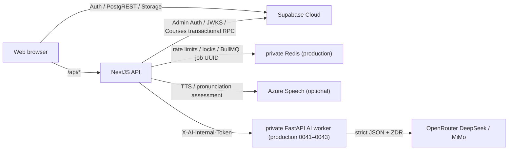

# API documentation

> **Contents:** Records the current NestJS public API, the production 0041–0043 FastAPI internal endpoints, and the Supabase Auth/PostgREST/Storage data plane the browser uses directly; also points out target APIs that are not implemented yet.
> **Purpose:** Gives a clear contract for frontend/backend integration, client development, automated testing, security review, and API evolution, so endpoints from the architecture blueprint are not mistaken for ones that already work.  
> **When to update:** In the same commit as the implementation, whenever routes, requests/responses/status codes, authentication/authorization, data schemas, Supabase access patterns, error codes, or the API versioning policy are added, removed, or changed.

## 1. Current API boundary



- Production Web/API same-origin base URL: `https://nalanda.online`; examples in this document default to local `http://localhost:3000`.
- NestJS global prefix: `/api`.
- FastAPI default local base URL: `http://localhost:8000`; production only allows access from the compose private network. Since 0041 it is called by the BullMQ consumer with an internal token, and production 0043 has this chain deployed.
- There is currently no OpenAPI file, API version number, request ID, or common pagination convention. Nest global errors are unified as `{ code, message, fieldErrors?, currentRevision?, retryAfterSeconds? }`. Production 0039–0040 enabled global Redis rate limiting.
- NestJS CORS permission comes from `CORS_ALLOWED_ORIGINS`, falling back to `PUBLIC_ORIGIN` when unset; when both are missing in production no CORS permission is returned, same-origin nginx `/api` is unaffected, and credential cookies are not enabled today.

## 2. Authentication conventions

### 2.1 Browser sign-in chain

1. On sign-up the browser calls `POST /api/auth/register`; the API uses the service role to call Supabase Admin Auth and create a confirmed user.
2. The browser then calls `supabase.auth.signInWithPassword` directly to get a Supabase session.
3. When calling protected NestJS endpoints it sends:

```http
Authorization: Bearer <supabase-access-token>
```

4. The API first fetches public keys from `<SUPABASE_URL>/auth/v1/.well-known/jwks.json`, only accepts ES256/RS256, and validates the issuer, `audience=authenticated`, a UUID `sub`, and `role=authenticated`; legacy HS256 projects can fall back to `SUPABASE_JWT_SECRET` with the same claim checks.

Courses, sessions, reviews, Profile learning aggregates, speech, share cloning, and market publishing/cloning/reporting are all bearer endpoints, except public share previews and the market list. The Web app's Materials, community, ordinary plans, legacy Profile, feedback, and notifications still mostly connect directly through `supabase-js`.

### 2.2 Error format

NestJS global error format:

```json
{
  "code": "INVALID_COURSE",
  "message": "Course content failed validation",
  "fieldErrors": { "units.0.words.1.term": "Must be unique within the unit" }
}
```

`fieldErrors` is optional; unknown 4xx map to `INVALID_REQUEST`, 413 to `PAYLOAD_TOO_LARGE`, and unknown 5xx to `INTERNAL_ERROR`. Common statuses: 400 parameters/contract, 401 token, 403 owner/admin, 404 not found or feature hidden, 409 conflict, 413 multipart limit, 429 quota, 502 provider, 503 feature flag/dependency unavailable. The internal FastAPI uses Pydantic `422 detail` and stable AI error codes, which NestJS converts before anything is returned to the browser.

### 2.3 Production 0039–0040: general rate limiting

After the Nest guard authenticates, a global interceptor applies an atomic Redis sliding window; nginx additionally layers API 20 req/s burst 40 and sign-up 1 req/s burst 3. Keys only contain the user UUID or `HMAC-SHA256(IP/email)`, and raw IPs/emails are never written to Redis, Postgres, or logs.

| Route group | Rule |
|---|---|
| Sign-up | IP 5/15 minutes + normalized email 3/hour |
| All authenticated APIs | user 300/minute |
| Courses writes (including speech/judgement/clone/report) and session/audio GETs that can trigger the TTS queue | The above + user 120/minute + IP 60/10 seconds; durable provider quotas still stack on top |
| Public Course Market/share GET | IP 120/minute |

Rejections return 429, `Retry-After`, and `RateLimit-Limit/Remaining/Reset/Policy`:

```json
{ "code": "RATE_LIMITED", "message": "Too many requests", "retryAfterSeconds": 42 }
```

When Redis fails, sign-up, writes, public Courses reads, clone/report, and cost paths return `503 RATE_LIMIT_UNAVAILABLE`; authenticated private reads fail open and write a `rate_limit_degraded` structured log. The Courses outbox keeps the original attempt UUID and retries serially after `retryAfterSeconds`; audio manifest polling backs off and never marks a 429 as an audio generation failure.

429s triggered by nginx itself also return the same JSON, `Retry-After`, and `RateLimit-Limit/Remaining/Reset`; 429s from the Nest upstream are not intercepted, so the exact user/window headers stay intact. HMAC only covers application audit data and doesn't change the retention policy of nginx's existing basic access logs.

## 3. NestJS API (current implementation)

### `GET /api/health`

Authentication: none.  
Implementation: `apps/api/src/health/health.controller.ts`.

Response `200`:

```json
{
  "status": "ok",
  "service": "nalanda-api",
  "time": "2026-07-10T00:00:00.000Z",
  "deps": {
    "redis": "ok",
    "ai": "unset",
    "supabase": "ok"
  }
}
```

Semantics: before returning 200 it calls Supabase JWKS and `profiles?select=id&limit=0`, validates the HMAC secret, and runs a real Redis PING. If either Supabase or Redis is unavailable it returns 503, exposing only dependency status; AI still only shows `configured/unset`. Storage, sign-up writes, RLS, and full user paths are not verified by this endpoint.

Failure response `503`:

```json
{
  "status": "error",
  "service": "nalanda-api",
  "time": "2026-07-10T00:00:00.000Z",
  "deps": { "redis": "unavailable", "ai": "unset", "supabase": "unavailable" }
}
```

Example:

```bash
curl -fsS http://localhost:3000/api/health
```

### `POST /api/auth/register`

Authentication: none.  
Content-Type: `application/json`.  
Implementation: `apps/api/src/auth/auth.controller.ts`.

Request:

```json
{
  "email": "developer@example.com",
  "password": "at-least-6-characters"
}
```

Processing rules: the email is trimmed and lowercased and checked with a simple email regex; the password needs at least 6 characters. On success a user with `email_confirm=true` is created through the Supabase Admin API.

| HTTP | `code` | Meaning |
|---:|---|---|
| 200 | — | `{ "ok": true }`; only means creation succeeded, no session is returned |
| 400 | `INVALID_EMAIL` | The email fails the current regex |
| 400 | `WEAK_PASSWORD` | The password is shorter than 6 characters |
| 400 | `REGISTER_FAILED` | Unclassified Supabase sign-up failure |
| 409 | `EMAIL_TAKEN` | The email already exists; detected from the status code or upstream text heuristics |
| 500 | `SERVER_MISCONFIG` | The API is missing `SUPABASE_URL` or the service-role key |
| 502 | `UPSTREAM_UNREACHABLE` | The API can't reach Supabase Auth |
| 429 | `RATE_LIMITED` | The rate-limit window is full; retry after `Retry-After` |
| 503 | `RATE_LIMIT_UNAVAILABLE` | Redis is unavailable, so sign-up fails closed |

Example:

```bash
curl -i http://localhost:3000/api/auth/register \
  -H 'Content-Type: application/json' \
  --data '{"email":"developer@example.com","password":"change-me"}'
```

This endpoint creates real accounts, so it shouldn't be used as an ordinary smoke test without cleanup and must not be run repeatedly against production. The production app has two-layer IP+email Redis rate limiting and HMAC auditing; there is still no CAPTCHA, proof of email ownership, or extended password strength rules.

### `GET /api/me`

Authentication: Supabase bearer token.  
Implementation: `apps/api/src/me/me.controller.ts` and `apps/api/src/auth/supabase.guard.ts`.

Success `200`:

```json
{
  "user": {
    "id": "00000000-0000-0000-0000-000000000000",
    "email": "developer@example.com",
    "role": "authenticated"
  }
}
```

`id` comes from the JWT `sub`; `email` and `role` may be absent, so clients must treat them as optional. This endpoint doesn't query `profiles`.

Failure `401`: without a token the message is `Missing bearer token`; on a verification failure or missing `sub` it is `Invalid token`.

```bash
curl -fsS http://localhost:3000/api/me \
  -H "Authorization: Bearer $SUPABASE_ACCESS_TOKEN"
```

Here `$SUPABASE_ACCESS_TOKEN` means the user's sign-in access token, not the Supabase Personal Access Token used for database migrations; the two must never be mixed up.

### Production 0039–0040: Points admin endpoints

All three routes require a Supabase bearer token and then check `MODERATION_ADMIN_USER_IDS`; during the compatibility period they fall back to `COURSE_MARKET_ADMIN_USER_IDS` only when the new variable is empty. There is no admin UI, and ordinary users and anonymous requests must not read signals or call moderation transactions.

| Method | Path | Request/query | Success response |
|---|---|---|---|
| GET | `/api/admin/points/abuse-signals?status=pending&limit=50` | status=`pending/reviewing/dismissed/escalated`, limit 1–100 | Redacted `PointAbuseSignal[]`, without the internal fingerprint |
| PATCH | `/api/admin/points/abuse-signals/:id` | `{status:"reviewing|dismissed|escalated",reviewNote?,caseReference?}` | The updated signal; reviewer/time are kept |
| POST | `/api/admin/points/moderation-actions` | `ModeratePointRewardsRequest` | `PointModerationResult` |

Moderation request example:

```json
{
  "action": "suppress",
  "targetType": "post",
  "targetKey": "00000000-0000-4000-8000-000000000000",
  "reason": "Confirmed coordinated engagement",
  "caseReference": "CASE-2026-001"
}
```

`targetType=post` resolves the root content key inside the database and covers the original, repost, like, and comment rewards anchored on that root; it only reverses the amounts actually awarded historically. `restore` doesn't re-award claims with a zero daily cap and doesn't restore deleted sources. Each action appends to `point_moderation_actions`, and a reason is required. PATCH reviews write the database time and reviewer through the service-only `review_point_abuse_signal`; the API service role only has SELECT on claims, signals, and moderation actions, so it can't bypass the controlled RPCs to rewrite them directly.

## 4. Courses API (feature migrations 0011–0038, overall production history at 0043)

All requests/responses use camelCase from `@nalanda/types`; the API explicitly converts PostgreSQL snake_case internally. Everything not marked "public" needs a Supabase bearer token. `FEATURE_LEARNING_COURSES_ENABLED` is the master switch, and sharing, market, and speech have their own sub-switches; when not explicitly enabled in production they return 503/404 respectively, and clients must not fall back to a frontend mock because of that.

The 0019–0020 contract adds timed spelling and the OpenRouter semantic translation pre-test, which passed the production migration history, immutable application release, real provider, and candidate API gates on 2026-07-28. 0021–0022 don't change the HTTP request/response structure; they only make the seven-parameter authoritative answer RPC apply the same NFKC, Unicode whitespace/punctuation variant, and ASCII case normalization as the Web app to the user's answer and the course's original `term`, released through the protected flow on 2026-07-31. The time limit itself is enforced by the Web app; the server still decides the retry pool, revision, progress, and rewards from immutable attempts.

0023–0024 keep the HTTP contract unchanged but judge answers that only omit, replace, or add punctuation as correct; errors in letters, digits, word order, and inter-word spaces with no punctuation involved are still wrong. This behavior was released to production through a separate plan/apply on 2026-07-31.

0025–0028 add explicit session cancellation, end-of-round confirmation for spelling, exam mode, and real provider quota reservation; they were released to production on 2026-08-01 through separate read-only plan `30706279006` and protected apply/deploy `30706731292`, and the new endpoints in the tables below are live.

### 4.1 Course content

| Method | Path | Request | Success response |
|---|---|---|---|
| GET | `/api/learning-courses` | — | `LearningCourseSummary[]`, ordered by `updatedAt` descending |
| POST | `/api/learning-courses` | `LearningCourseInput` | `LearningCourseDetail`, the whole course created in one transaction |
| GET | `/api/learning-courses/:id` | — | The owner's `LearningCourseDetail` |
| PUT | `/api/learning-courses/:id` | `LearningCourseInput`; the path ID overrides the body ID | The updated `LearningCourseDetail`; adding/removing units/words or changing word content ends the old queue, while renaming, reordering, and moving don't |
| PATCH | `/api/learning-courses/:id` | `{ "title": "..." }` | The renamed detail; doesn't reset learning abilities/sessions |
| DELETE | `/api/learning-courses/:id` | — | `{ "ok": true }` |

Create/whole-course save request:

```json
{
  "id": "11111111-1111-4111-8111-111111111111",
  "title": "CET-6 Vocabulary",
  "category": "english_vocabulary",
  "hasUnits": true,
  "locale": "en-US",
  "units": [
    {
      "id": "22222222-2222-4222-8222-222222222222",
      "name": "Unit 1",
      "isSystem": false,
      "words": [
        {
          "id": "33333333-3333-4333-8333-333333333333",
          "term": "take part in",
          "translations": ["参加", "参与"],
          "ipa": null
        }
      ]
    }
  ]
}
```

(Translations are Chinese because Courses teaches English vocabulary with Chinese meanings.)

Contract limits: course name 1–80; 1–100 units; at least one word per unit; 4–2,000 distinct normalized English words/phrases per course; term 1–120, only accepting English letters, digits, spaces, dots, hyphens, and straight/curly apostrophes, with at least one letter; 1–10 distinct non-empty translations per word, each ≤120; IPA ≤120. Unit-less mode must be a single hidden unit with `isSystem=true`. The first version rejects other categories/locales. A missing IPA is filled in by the server from CMUdict when possible and stays null otherwise.

The API JSON body limit is 10 MB, covering the valid worst case of 2,000 words with multiple translations; beyond that it returns the unified 413. Read-aloud scoring is a separate multipart boundary and is still strictly limited to 2 MB.

`LearningCourseSummary` fields: `id,title,category,hasUnits,locale,unitCount,wordCount,learnedCount,progressPercent,activeSessionId,canRepublish,originPublicationId,originShareId,originAuthorName,updatedAt`. The two origin IDs only appear in the cloner's own private responses and are never exposed in public previews; Detail additionally contains units/words ordered by position and each word's `progress`: the four initial stages, three review-date groups, cumulative errors, review count, and `learnedAt`.

### 4.2 Learning sessions, answers, and reviews

| Method | Path | Request | Success response |
|---|---|---|---|
| POST | `/api/learning-courses/:id/sessions` | `{ unitId, mode: "initial"|"review"|"exam", skills?, scope?, scheduleId?, spellingOptions?, examPassPercent?, examKind?: "spelling"|"pronunciation", wordIds?: uuid[] }` | Creates or resumes the active `LearningSession` that exactly matches the request intent; since 0031, `wordIds` is only allowed for review/exam, with 1–2,000 distinct words that belong to the owner/unit/scope |
| GET | `/api/learning-exams?courseId?` | — | 0031: summaries of the owner's latest 100 exams; can be filtered by the user's own course, distinguishing in progress/cancelled/completed, whether the first round passed, and whether wrong-answer practice was completed |
| GET | `/api/learning-exams/:sessionId` | — | 0031: the owner's exam detail, returning the final status and time-ordered raw spelling answers/redacted pronunciation scores from the private word snapshots taken at exam creation/completion; later edits/word deletions never rewrite old details, and no WAVs, keys, or full provider payloads are returned |
| GET | `/api/learning-sessions/:id` | — | The current owner's full session/items/state/revision; the API reads it internally with one `learning_get_session_snapshot` RPC |
| POST | `/api/learning-sessions/:id/cancel` | `{}` | `LearningSessionCancelResult`: `{ sessionId,active:false,revision,cancelled }`; repeated cancellation idempotently returns `cancelled:false` |
| POST | `/api/learning-sessions/:id/recognition` | `{ wordId }` | `{ revision, sessionPatch }` |
| POST | `/api/learning-sessions/:id/attempts` | `LearningAttemptRequest` | `LearningAttemptResult`; only returns this attempt's facts and the session delta |
| POST | `/api/learning-sessions/:id/spelling-translation-assessments` | `{ attemptId,expectedRevision,wordId,answer }` | `LearningSpellingTranslationAssessmentResult`; a semantic error already includes the authoritative spelling `attemptResult` |
| POST | `/api/learning-sessions/:id/spelling-translation-transcriptions` | `multipart/form-data`: `audio`, `wordId`, `expectedRevision` | `{ text,wordId,revision,language }`; only recognizes Chinese for the current translation-first spelling question and returns editable text, without submitting an answer or advancing the session |
| POST | `/api/learning-sessions/:id/spelling-retry-rounds/continue` | `{}` | `{ revision,sessionPatch }`; at end-of-round confirmation the server shuffles the wrong words and starts the next round; a replay of the same round after a lost response idempotently returns the current patch without reshuffling or advancing the revision |
| POST | `/api/learning-sessions/:id/exam-retry-rounds/continue` | `{}` | 0029: the general end-of-round confirmation for spelling/pronunciation exams; locks the owner session, shuffles the wrong words, advances the revision, and clears the durable review state |
| GET | `/api/learning-review-schedules` | — | `ReviewSchedule[]`, including course/unit names and source/completed session IDs |
| POST | `/api/learning-units/:id/review-schedules` | `{ sourceSessionId, offsets: number[] }`; the source must be the user's own completed initial session for that unit; offsets are only 3/7/15/30 | All of the current user's schedules |
| DELETE | `/api/learning-review-schedules/:id` | — | `{ "ok": true }`, status changes to cancelled |
| GET | `/api/profile/learning-summary` | — | `{ courses, learnedWords, reviewDays, badges }` |

Review `skills` are 1–3 of `pronunciation/translation/spelling`, and `scope` is `all/unlearned`. When started with `scheduleId`, the server ignores the client-reported skills/scope and uses the values saved on the schedule; on completion it atomically writes `completedSessionId/completedAt`. Attempt shape:

Exam `mode="exam"` must specify one unit of the user's own course; `examPassPercent` is an integer from 1–100, defaulting to 90. `examKind` defaults to `spelling`, and since 0029 also accepts `pronunciation`. The server ignores self-reported `skills/scope`: the spelling exam uses `skills=["spelling"]`, `translationFirst=true`, and the pronunciation exam uses `skills=["pronunciation"]`, `translationFirst=false`. Since 0031 a `wordIds` subset is allowed, and the database re-validates each ID's owner/course/unit; without it the whole unit is used. The authoritative spelling attempts or Azure-backed speech assessments of the full first round determine the accuracy; wrong-answer practice never changes that score. After every retry is corrected the session ends automatically, whether or not it met the threshold, and writes `practiceCompleted`; meeting the threshold in the first round only writes the corresponding `spellingExamPassedAt` or `pronunciationExamPassedAt` for the selected words. Since 0033, a non-null `learnedAt` is only returned when both exam facts of the same word exist. These contracts were enabled in production with 0029–0034 on 2026-08-03.

Review `wordIds` are likewise a production capability since 0031. NestJS pre-validates UUIDs/count/dedupe, and the selected-review RPC then validates the owner, course, unit, and, with `scope=unlearned`, that each word really isn't learned yet; Schedule starts still follow the skills/scope saved on the schedule and only allow narrowing the word set within it. The selected set is written into session items/state; ad-hoc reviews and exams use a fingerprint of the normalized set in the resume key, so the same set in a different client order never produces a different semantic set. Schedule keeps one active session per schedule; after the first start, continued learning uses the already fixed selection, and the scope can't be replaced midway.

`progress.spellingExamPassedAt`, `progress.pronunciationExamPassedAt`, and `progress.learnedAt` in responses, as well as the list's `learnedCount/progressPercent`, are all server-derived facts; there is no client API to "manually mark as learned". Since 0033, reviews only record practice no matter how many cross-day pronunciation/translation/spelling facts accumulate; `learnedAt` is only written when the same word has passed and completed both a spelling exam and a pronunciation exam, so both exam timestamps exist. Completing the four initial stages, recognition, creating/completing review schedules, pausing/cancelling, offline provisional completion, a single exam, or a failed exam never write it. In `PUT /api/learning-courses/:id`, changing the term clears both exam facts, changing translations only clears the spelling exam fact, and changing IPA only clears the pronunciation exam fact; any fact becoming invalid clears `learnedAt`. The full rules and code index are in section 4 of the [Courses English vocabulary learning document](../notes/11-learning-courses.md).

Since 0017, the session resume key is generated from the server-validated intent: initial learning uses `course+unit+initial`, ad-hoc reviews use `course+unit+scope+sorted skills`, and scheduled reviews use the schedule ID. A paused initial learning session and a review of another unit can both stay active; concurrent requests with the same intent still converge on the same session through an advisory lock and a partial unique index. `activeSessionId` is the course card's shortcut entry, and the API picks the most recently active one by `lastActivityAt`; it doesn't mean a course can only have one unfinished session.

An active session's `unitId` always points to an existing unit; if a course edit deletes that unit, the historical session is terminated and kept, its `unitId` can be `null`, and clients should render it as a historical record that can't be continued.

"Pause and return" only leaves the current page, and the active session can still be resumed; "Cancel learning" sets the session inactive and advances the revision through an owner-only server transaction. Cancelling doesn't delete confirmed attempts/progress and doesn't change unfinished review schedules to cancelled; the Web app only clears the pending-sync outbox for the current account and current session after the server confirms. After cancelling, the same intent creates a new session.

`spellingOptions` only takes effect when spelling is selected, with the defaults:

```json
{
  "timeLimitEnabled": false,
  "timeLimitSeconds": 20,
  "translationFirst": false
}
```

`timeLimitSeconds` must be an integer from 3–300. When resuming a same-intent session whose revision is already greater than 0, the server keeps that session's original settings so another device can't change the rules midway; a revision-0 session with no immutable facts yet can be configured by the start request. With timing on, each spelling question's countdown only starts once it becomes answerable; with the translation pre-test on, the countdown starts after the semantic judgement passes and the spelling input appears. On timeout the current input (empty strings allowed) is submitted exactly once, and error feedback still waits for the user to move to the next question manually.

```json
{
  "attemptId": "44444444-4444-4444-8444-444444444444",
  "expectedRevision": 12,
  "wordId": "33333333-3333-4333-8333-333333333333",
  "skill": "translation",
  "answer": { "translations": ["参加", "参与"] }
}
```

Pronunciation matching uses `answer.wordId`, and spelling uses `answer.text`. The Web provisional spelling judgement and the PostgreSQL authoritative judgement use the same algorithm: NFKC first, then curly/straight apostrophes and common hyphen variants are normalized to ASCII, leading/trailing/repeated Unicode whitespace is collapsed, and finally only English `A–Z` is deterministically lowercased; this runs on both the answer and the course's original `term`, and the client-supplied `normalizedTerm` is never trusted. So `APPLE`, `ＡＰＰＬＥ`, and `apple` are equivalent, and `YOU’RE` and `YOU'RE` are equivalent, but omitting an apostrophe, hyphen, or period is still wrong.

`attemptId` must be a UUID; `expectedRevision` must equal the current session revision. The server first looks up the first response by `(user_id,session_id,attempt_id)`, then locks the session, validates the revision, atomically records the append-only attempt, updates the retry pool/cursor/stage/progress/revision, and saves the response snapshot. A timeout replay with the same attempt UUID returns the first result with `replayed=true`, without advancing again or adding an error; a stale revision returns `409 { code:"SESSION_REVISION_CONFLICT", message, currentRevision }`.

With the translation pre-test on, the Web app first calls the semantic endpoint with the same `attemptId`:

```json
{
  "attemptId": "44444444-4444-4444-8444-444444444444",
  "expectedRevision": 12,
  "wordId": "33333333-3333-4333-8333-333333333333",
  "answer": "参与某个活动"
}
```

(The answer is the user's Chinese translation of "take part in".)

NestJS reads the English and the authoritative translations from the current owner/session/word. If the user's answer, after server-side NFKC, whitespace, and case normalization, exactly equals any reference item, it is judged correct deterministically with `nalanda-normalized-exact/normalized-exact-v1` without calling the provider; only non-literal answers are passed, in request memory, to OpenRouter's free `nvidia/nemotron-3-super-120b-a12b:free` (Nvidia-only, no fallback, reasoning off). The request uses JSON Object mode, and the API locally requires exactly one field `{correct:boolean}` and requires the response provider to be Nvidia; extra fields, missing fields, wrong types, or bad JSON all fail closed. The browser can't submit reference answers or model names; the server fills in feedback with fixed safe copy and never treats provider free text as an authoritative meaning. The database only persists the SHA-256 of the user's answer, provider/model, the boolean, short feedback, token usage, the lease, and the first response, never the input text. When correct, the revision doesn't advance, and a spelling attempt must then be submitted with the **same UUID**; when wrong, the server immediately records one spelling error atomically with that UUID and returns:

```json
{
  "attemptId": "44444444-4444-4444-8444-444444444444",
  "correct": false,
  "expected": ["参加", "参与"],
  "feedback": "The answer does not express the expected meaning.",
  "revision": 13,
  "replayed": false,
  "attemptResult": {
    "attemptId": "44444444-4444-4444-8444-444444444444",
    "correct": false,
    "expected": "take part in",
    "revision": 13,
    "replayed": false,
    "sessionPatch": {}
  }
}
```

The `sessionPatch` above omits the same fields as an ordinary attempt. Replays with the same UUID + same answer hash never call the provider again or advance the session; reusing the UUID with a different session/word/revision/answer is rejected. Provider timeouts, network errors, or a missing valid boolean twice release the lease and return a retryable error without recording an error; an invalid structure on the first HTTP 200 is retried once only within the original total timeout budget. Empty feedback uses fixed safe copy, so a valid boolean is never mistaken for a failure. The same unexpired lease returns 425, a revision conflict returns 409, and the user limit returns 429. `expected` and the UI result always show both the correct spelling and the separate translation text blocks.

The judgement claim itself no longer consumes OpenRouter quota. Exact normalized matches and idempotent replays keep `quota_counted=false/quota_counted_at=null`; only when a provider-backed judgement is about to be sent does the API call the service-only reservation RPC to atomically write true/the current time, and the rolling windows are computed from that moment. Network retries for the same assessment UUID don't consume product quota again. The defaults are 20 per minute and 500 per rolling 24 hours per user. 429s use `TRANSLATION_ASSESSMENT_MINUTE_LIMIT` or `TRANSLATION_ASSESSMENT_DAILY_LIMIT` respectively, and the standard envelope additionally carries `retryAfterSeconds`; a real provider call that was sent but failed keeps that quota fact, but is never recorded as a learning error.

During the database-first and immutable Web/API switchover, 0014 pages may still send old full requests missing both `attemptId` and `expectedRevision`; the API temporarily calls the retained five-parameter service-role RPC only for this "both missing" shape, and the revision trigger still advances. Missing only one of the fields is rejected. The official 0015 Web app, weak-network retries, and all new integrations must use the idempotent contract above; the compatibility branch and the old RPC are removed together through a new forward migration/application version after the stability window.

Success response:

```json
{
  "attemptId": "44444444-4444-4444-8444-444444444444",
  "correct": false,
  "expected": ["参加", "参与"],
  "revision": 13,
  "replayed": false,
  "sessionPatch": {
    "stage": "translation",
    "active": true,
    "state": {
      "queue": ["33333333-3333-4333-8333-333333333333"],
      "cursor": 0,
      "nextQueue": [],
      "round": 2
    },
    "changedItem": {
      "wordId": "33333333-3333-4333-8333-333333333333",
      "recognitionSeen": true,
      "pronunciationPassed": true,
      "translationPassed": false,
      "spellingPassed": false,
      "wrongCount": 2
    },
    "nextWordId": "33333333-3333-4333-8333-333333333333"
  }
}
```

The client computes provisional correctness from the loaded session in the same render frame: correct answers move to the next question automatically after about 520 ms, while wrong answers stay until the user clicks "Next question". This prediction never grants completion, points, or badges; the IndexedDB outbox submits serially by revision, and the server delta replaces the prediction. The full snapshot is only refetched on cold start/exit, server-confirmed completion, or a revision conflict; ordinary questions don't refresh the Courses list.

When a spelling round ends with wrong words, the attempt's returned `sessionPatch.state` carries `awaitingRetryConfirmation=true`, `retrySummaryIds`, and `retryFromRound`. The pronunciation exam uses the same fields plus `retrySummaryScores: Record<wordId, PronScore>`. Until the round-continuation endpoint is called, the database rejects new attempts/scoring and translation judgement processing claims; the continuation endpoint locks the owner session, advances the revision, clears the confirmation flag, and reorders the wrong words by session/round. So the end-of-round list is refresh-recoverable server state, not a purely frontend dialog.

### 4.3 Pronunciation synthesis and read-aloud scoring

| Method | Path | Request | Success response |
|---|---|---|---|
| POST | `/api/learning-units/:id/audio-prewarm` | owner unit; empty JSON body | Idempotently writes the whole unit into the durable generation queue and returns `LearningAudioManifest` |
| GET | `/api/learning-units/:id/audio-manifest` | owner unit | `{ unitId,total,ready,pending,failed,synthesisVersion,assets[] }`; assets only give API audio URLs, never Storage URLs |
| GET | `/api/pronunciation/audio/:wordId` | A word ID in the owner's course | When ready, `audio/mpeg` (WAV for the fake), an ETag, and `private,max-age=31536000,immutable`; when not ready, a fast `202 AUDIO_PENDING` + `Retry-After: 3` |
| POST | `/api/pronunciation/assess` | `multipart/form-data`: `audio`, `sessionId`, `wordId` | `PronunciationAssessment` |

Scoring only accepts words in the current user's active session; both the recognition stage and the pronunciation exam require `wordId` to be the current card, and while waiting for end-of-round confirmation the request is rejected before calling Azure, so late/forged requests can't change other words or consume quota. The browser no longer does VAD, noise thresholds, minimum "clear speech" duration checks, silence trimming, or content truncation; recording lasts at most 6 seconds with echo cancellation, noise suppression, and auto gain control off. The Web app only converts device frames into the 16 kHz/16-bit/mono PCM WAV that the Azure REST API requires, and the server validates ≤2 MB, ≤8 seconds, and the format before forwarding the same byte sequence to Azure. The reference text is always fetched on the server from the wordId. Response fields are `accuracyScore,fluencyScore,completenessScore,pronunciationScore,passThreshold,passed,queuedForRetry,revision,sessionPatch,errorType,phonemes[]`, so the full session doesn't need to be refetched. The overall `pronunciationScore` passes at 70 by default: a low score in the recognition stage updates the recognition `nextQueue`; a low score in the pronunciation exam updates the exam retry pool and first-round statistics. The threshold is a controlled API configuration and is re-validated by the database as 1–100. Each phoneme contains `accuracyScore` and a derived `needsPractice` for `<70`.

0037 reuses the same WAV capturer to provide Chinese voice input for the translation before spelling, released through the protected flow with 0038 on 2026-08-04. NestJS always calls OpenRouter `/audio/transcriptions` with `fish-audio/transcribe-1`, and the request's `language` defaults to `zh`; the browser can't submit a model/language/key. Before any provider cost, a database RPC atomically validates the owner, active spelling stage, `translationFirst=true`, the current `wordId`, and `expectedRevision`. The response only fills the input box; it creates no attempt, doesn't grade, and doesn't advance the cursor; if a slow response no longer matches the current revision/word, the Web app discards it rather than filling the next question by mistake. User audio and transcripts never enter the database, Storage, backups, or logs; only the cost/quota facts in `learning_speech_usage.kind=translation_stt` are persisted.

Provider 402 maps to `503 TRANSLATION_STT_PROVIDER_CREDIT_REQUIRED`, and 429 maps to `TRANSLATION_STT_PROVIDER_RATE_LIMIT`; both only turn off voice fill for this attempt and keep keyboard input, without creating a wrong attempt. This model is not a `:free` text model, and reusing the same key doesn't mean reusing the free quota.

User recordings are never stored; only the scoring JSON is written to the append-only attempt. `RECORDING_TOO_QUIET` is no longer produced locally; missing bytes, an invalid format, the provider not recognizing speech, or a timeout are each handled by the existing upload/provider errors, and none of them create a learning error based on a client-side judgement. TTS GET no longer calls Azure synchronously: after the owner check it only raises the word job's priority, and the worker processes globally with single concurrency, at least 3.1 seconds apart, a default of 20 per minute, and 500,000 characters per month. Private Supabase Storage is the server's single source of truth for audio; HTTP 400 + JSON 404 only means a normal missing object and triggers a rebuild, while network/permission/other Storage failures stay visible and never masquerade as a miss that wastes Azure. Browser Cache Storage is a deletable, reclaimable copy and produces no anonymous Storage URLs. Common errors: `AUDIO_PENDING`, `AUDIO_REQUIRED`, `INVALID_AUDIO(_FORMAT)`, `AUDIO_TOO_LONG/LARGE`, `WORD_NOT_IN_SESSION`, `SPEECH_TTS_RATE_LIMIT`, `SPEECH_TTS_MONTHLY_LIMIT`, `SPEECH_QUOTA_EXCEEDED`, `SPEECH_PROVIDER_*`.

### 4.4 Sharing, free course market, and reports

| Method | Path | Auth | Request/response |
|---|---|---|---|
| POST | `/api/course-shares` | bearer | `{ courseId }` → `{ id, token, url }`; the token only appears in the creation response |
| GET | `/api/course-shares?courseId=:id` | bearer | Active share metadata for the course, without token/hash |
| DELETE | `/api/course-shares/:id` | bearer | `{ ok:true }`, revoked immediately |
| GET | `/api/public/course-shares/:token` | public | A redacted `PublicCoursePreview` snapshot of the current course |
| POST | `/api/course-shares/:token/clone` | bearer | The private `LearningCourseDetail` after a free clone |
| POST | `/api/learning-courses/:id/publications` | bearer | `{ description, rightsDeclared:true }` → publication preview |
| GET | `/api/course-market` | public | Up to 100 published `PublicCoursePreview`, newest first |
| POST | `/api/course-publications/:id/clone` | bearer | The private detail after a free clone |
| POST | `/api/course-reports` | bearer | `{ publicationId|shareId, category, details }` → `{ id,status }` |
| PATCH | `/api/course-publications/:id/moderation` | bearer + configured admin | `{ action:"hide"|"restore"|"withdraw", reason }` → moderation result |

Public previews only contain the publication/share ID, title, description, author display name, English category/locale, version, unit/word counts, cloneCount, creation time, and `units[{name,position,isSystem,words[{term,translations,ipa}]}]`; they contain no owner ID, progress, attempts, schedules, token hash, or economy fields. Shares read the source course's current content; publications are immutable snapshots. Cloning randomly generates all course/unit/word IDs, resets progress to zero, and sets `canRepublish=false`.

Report category: `abuse/copyright/privacy/spam/academic_integrity/other`, details ≤1000; exactly one of publicationId/shareId is required. Reaching the report threshold only writes a structured alert and never auto-delists. Exceeding the daily publish/report limits returns 429 `PUBLISH_LIMIT`/`REPORT_LIMIT` respectively.

### 4.5 Feature-flag errors

| Condition | HTTP/code |
|---|---|
| Courses master switch off | 503 `COURSES_DISABLED` |
| Sharing off | 404 `SHARING_DISABLED` |
| Market off | 404 `MARKET_DISABLED` |
| Speech off, circuit open, or missing configuration | 503 `PRONUNCIATION_UNAVAILABLE` |
| Audio prewarm sub-switch off | 503 `AUDIO_PREWARM_DISABLED` |
| Stale session revision | 409 `SESSION_REVISION_CONFLICT` + `currentRevision` |
| OpenRouter per-minute actual provider quota reached | 429 `TRANSLATION_ASSESSMENT_MINUTE_LIMIT` + `retryAfterSeconds` |
| OpenRouter rolling 24-hour actual provider quota reached | 429 `TRANSLATION_ASSESSMENT_DAILY_LIMIT` + `retryAfterSeconds` |
| Courses quota/cost variables aren't finite positive numbers | 503 `SERVER_MISCONFIG` |

## 5. Materials AI, Notes, knowledge graph, and online exams

The basic exam paper/exam endpoints shipped with production 0041–0043; the 0049–0051 database was applied through the protected flow on 2026-08-14, and 0054–0055 were applied and verified through the protected flow on 2026-08-23. The application candidate of main run `32931681321` rolled back automatically after failing the DocumentIR DOCX semantic quality gate; the new 0046–0057 application endpoints still need later successful cutover evidence before they count as publicly enabled. All use a Supabase Bearer JWT, responses are camelCase, and errors are `{ code, message, fieldErrors? }`. The master switch and the Luna sub-switch are independent; when Luna lacks an Azure ZDR endpoint, the capability returns `OPENROUTER_ZDR_UNAVAILABLE` and never silently creates a DocumentIR job. The retired `ox_alpha_native_file_v1` is rejected with `INVALID_AI_JOB`.

| Method and path | Input/behavior | Key boundaries |
|---|---|---|
| `POST /api/materials/:id/ai-jobs` | Production supports `kind=exam`; the candidate adds `kind=knowledge_graph` and requires an explicit `pipeline=document_ir_v1|luna_native_file_v1`. All include a UUID `idempotencyKey`, versioned consent, and settings | owner, format/25 MB, daily generation reservation, one active job per user; same-key replays don't reserve again; original-file formats that didn't pass capability return a stable 400 |
| `GET /api/materials/:id/ai-capabilities` | Returns available/default/model/provider/reasonCode for the three pipelines | owner-only; Luna and Ox each require their sub-flag, a per-format allowlist, the live ZDR catalog, and a real provider gate; Ox only allows images; unavailability never auto-creates a DocumentIR job |
| `GET /api/ai-jobs?limit=50` | Recent jobs with stage/progress/stable errors/result references | owner-only; limit is clamped by the server |
| `GET /api/ai-jobs/:id` | A single job | owner-only |
| `POST /api/ai-jobs/:id/cancel` | Compatibility cancel entry, enters the durable `deleting/cleaning` | queued releases the reservation; once the worker has accepted, one is consumed; it only becomes cancelled after the purge is confirmed |
| `DELETE /api/ai-jobs/:id` | **0049–0051 candidate**: deletes one active or terminal job | Active jobs are interrupted and purged, and the record stays Cleaning up until completion is confirmed; Notes and usage audit records are kept |
| `POST /api/ai-jobs/clear-history` | **0049–0051 candidate**: clears all of the current user's succeeded/failed/cancelled jobs | Doesn't touch queued/processing/deleting; doesn't refund quota or delete Notes; each goes through the same purge confirmation |
| `POST /api/ai-jobs/:id/retry` | **0046–0048 candidate**: resumes the same retryable job | owner only; deadline/count/active-job checks; reserves again and reuses existing checkpoints without creating a new job |
| `GET /api/profile/ai-quota` | Free plan `used/reserved/remaining` for both kinds, timezone, `nextResetAt` | Computed by local day in the Profile's valid IANA time zone; default 10 each |
| `GET /api/notes` / `GET /api/notes/:id` | Private exam papers; the candidate also returns `ai_knowledge_graph` | The list is grouped by Materials course; detail is owner-only; the Graph contract doesn't reuse the Demo |
| `POST /api/notes/:id/knowledge-nodes/:nodeId/questions` | **Candidate** `{ idempotencyKey, question }` | The server reads the graph/source from the owner's Note; questions are at most 2000 characters, and success uses one generation quota |
| `GET /api/knowledge-questions/:id` | **Candidate** queries queued/processing/succeeded/failed and the grounded answer | owner-only; answer citations must belong to the selected node's source refs |
| `GET /api/notes/:id/knowledge-graph-layout` | **0049–0051 candidate**: reads the current artifact version, revision, node coordinates, and viewport | owner knowledge Note; when the artifact updates it returns the old-ID coordinates for the client to filter and reuse |
| `PUT /api/notes/:id/knowledge-graph-layout` | **0049–0051 candidate**: `{artifactVersion,expectedRevision,positions,viewport}` | At most 250 unique, existing node IDs; coordinates/zoom are bounded; conflicts return `GRAPH_LAYOUT_REVISION_CONFLICT` |
| `DELETE /api/notes/:id` | Deletes the exam paper/graph and its answer sheets/node questions | owner-only transaction; provider cost facts are kept |
| `DELETE /api/materials/:id?aiResults=keep|delete` | Deletes the source and keeps results in Unfiled, or deletes the AI results too | Cancels unfinished jobs and deletes parse caches and Storage objects (object deletion is best effort) |
| `DELETE /api/material-courses/:id?aiResults=keep|delete` | Same as above, for a Materials subject | Doesn't act on `learning_courses` |
| `POST /api/notes/:id/exam-attempts` | Starts a new exam | Unlimited retakes; the server writes an absolute `deadlineAt` |
| `PATCH /api/exam-attempts/:id/answers` | `{ operationId, expectedRevision, answers }` | Only saves drafts and never grades; operation UUIDs are idempotent and revision conflicts return 409; `in_progress` forces `results=[]` and contains no answer key |
| `POST /api/exam-attempts/:id/submit` | Same revision/operation contract, submits the whole paper | Grades all objective questions in one transaction and all subjective questions together in one AI grading call; requests after the deadline go through the same flow |
| `POST /api/exam-attempts/:id/grade` | Retries subjective grading after the quota resets | Daily grading reservation; the same attempt is never queued/charged twice |
| `GET /api/exam-attempts/:id` / `GET /api/notes/:id/exam-attempts` | Current answer sheet/history | owner-only; answers/explanations/rubrics are not revealed before completion |

Exam paper settings constraints: language `auto|en|zh`, four difficulty levels, 15–240 minutes, 20–200 points, 5–100 questions across six question types, total points no less than the question count, focus at most 200 characters. Graph settings are `{ language, detail:"comprehensive", focus }`. The full candidate state set also includes native auditing/generating and `deleting → cleaning`. Success consumes; system failures/rejections release; queued Delete/Cancel releases, and Delete/Cancel after the worker has accepted consumes once; retry reuses the same job/checkpoint and reserves again per the existing rules.

Each question in `GeneratedExamV1` contains a stable ID, question type, points, answer/explanation/rubric, and at least one source locator; the server validates the question count, total points, choice indexes, answers, and source citations. Short-answer/essay questions are only graded once, in a batch with a strict schema, after the whole paper is submitted; DocumentIR Notes use DeepSeek, and Luna Notes use the pinned Luna/OpenAI and only send the questions, rubrics, and user answers, without resending the source file. Other question types don't call a model.

The candidate `GeneratedKnowledgeGraphV1` contains 1–250 nodes and at most 1000 edges. Nodes have a stable ID, `sourceOrder`, level 0–12, type, summary, detailed explanation, details/examples/formulas/misconceptions/self-test/keywords, and 1–20 source refs; edges only allow `sequence|prerequisite|part_of|causes|supports|contrasts|applies_to|example_of|related`. The API explicitly converts snake_case→camelCase, and the Web app renders by source order.

### 5.1 Internal FastAPI (must never be exposed publicly)

| Path | Auth | Behavior |
|---|---|---|
| `GET /health` | compose private network access | Actually probes the OpenRouter configuration, LibreOffice, temporary disk, and internal token; fails when the production fake is on |
| `POST /internal/materials/jobs` | **Candidate** `X-AI-Internal-Token` | Fast 202 after validation; runs exam/knowledge_graph/knowledge_question in the background and calls back |
| `POST /internal/materials/jobs/:id/cancel` | **0049–0051 candidate**, same as above | Idempotently cancels the task/HTTPX/Office process group, first flushes the usage spool, then purges the directory; when unfinished it returns `purged:false` and the reconciler retries |
| `POST /internal/exams/jobs` | **Candidate**, same as above | Fast 202; subjective results are first written to a worker temporary recovery file and a private DB TTL checkpoint, then usage/complete are called back, so container replacement never grades twice |
| `POST /internal/materials/exam` | Compatibility synchronous route | For rolling back to the previous application and direct provider gates; must not be used as the candidate production long-job chain |
| `POST /internal/exams/grade` | Compatibility synchronous route | Same as above |

The candidate callback base is generated by the API, and the worker can only append `progress|usage|checkpoint|complete|fail`. Each carries the current lease token; for a processing or matching deleting lease, the API only accepts the corresponding narrow operation. Generation checkpoint stages additionally include `native_audited|native_artifact_ready`; grading checkpoints only accept a validated `{ result }`. Both default to 86400 seconds within a range of 300–604800 seconds, and neither is exposed through client PostgREST.

FastAPI request/response Pydantic models use `extra=forbid`; the internal token is compared in constant time. The old public `/parse` and `/generate/*` fixed stubs have been deleted.

### 5.2 Processing and provider rules

The deterministic parser keeps page/slide/block/table/formula/image relationships and diagnostics; after DeepSeek's first review, only the union of the parser's failed ranges and the failed ranges pointed out by the model is sent to MiMo, and the full IR is stitched back together and security-reviewed again. Both `malicious` and `uncertain` are rejected by the internal worker with HTTP 422 + `PROMPT_INJECTION_REJECTED`, while `benign_educational` can continue. Every OpenRouter request pins a single model, a strict JSON schema, disables reasoning/tools/Web, and sets `provider.zdr=true`, `data_collection="deny"`, `require_parameters=true`, `sort="throughput"`, `allow_fallbacks=true`; the last two prioritize throughput and only allow failover between compliant provider endpoints of the same model, and requests never provide a cross-model `models` list.

Postgres `generation_jobs`/`exam_attempts` are the durable facts, and BullMQ only stores UUIDs; the reconciler requeues queued/expired leases and holds a single execution slot until the terminal state/lease expiry. The candidate usage request adds a UUID `eventId`, so disconnect replays never double-bill thanks to a unique constraint; it must flush before completion and failure. The worker also briefly keeps the usage spool and validated checkpoints in a 0700 directory, and syncs validated generation/grading results to the private DB checkpoint; they are cleared on terminal state/TTL, and local copies must never be backed up. The default monthly total budget is US$20, with per-generation/grading caps of US$0.50/US$0.05; the usage ledger never stores prompts, source text, answers, or raw model responses.

Luna requests pin `openai/gpt-6-luna` and the actual Azure provider (GPT-6 Luna's only ZDR upstream). PDFs are sent as inline `type:file` + native parser, and images as inline `image_url`; the original bytes only exist in the current job directory, never enter DocumentIR/the parse cache, and are never uploaded to the OpenRouter Files API. Usage records `pipeline/upstreamProvider/upstreamEndpoint`; any success event showing a non-Azure upstream (including first-party OpenAI) is rejected at completion with `AI_PROVIDER_ROUTING_VIOLATION`, and the costs already incurred stay in the ledger.

New stable candidate errors: `AI_WORKER_TIMEOUT` (internal transport timeout), `AI_WORKER_UNREACHABLE`, `AI_CALLBACK_UNAVAILABLE`, `AI_JOB_NOT_RESUMABLE`, `AI_RESUME_EXPIRED`, `AI_WORKER_RETRY_EXHAUSTED`, `AI_KNOWLEDGE_GRAPH_VALIDATION_FAILED`, `KNOWLEDGE_NODE_NOT_FOUND`, `AI_LUNA_DISABLED`, `AI_LUNA_FORMAT_NOT_VERIFIED`, `AI_PROVIDER_ROUTING_VIOLATION`, `GRAPH_LAYOUT_REVISION_CONFLICT`, `GRAPH_ARTIFACT_CHANGED`. Retry/layout conflicts are 409; security/format/routing errors are not recoverable.

### 5.3 Historical FastAPI stubs (deleted, not callable)

The early repository provided unauthenticated `/parse` and `/generate/knowledge-list|quiz|graph|exam` fixed outputs; production 0041 deleted these routes. The old examples below only explain the historical mock and are not an API contract.

### `GET /health`

Response `200`:

```json
{
  "status": "ok",
  "service": "nalanda-ai",
  "claude": "unset"
}
```

`claude` only indicated whether `ANTHROPIC_API_KEY` was set; it didn't verify the key and didn't mean generation was wired up.

### `POST /parse`

Request:

```json
{
  "storage_path": "<user-id>/example.pdf",
  "material_type": "pdf"
}
```

Fixed response at the time:

```json
{
  "material_type": "pdf",
  "blocks": [],
  "text": ""
}
```

It didn't read Storage, download files, verify path ownership, or parse documents.

### Common request for the generation endpoints

The following four endpoints used the same request:

```json
{
  "material_id": "00000000-0000-0000-0000-000000000000",
  "text": "source text",
  "lang": "zh"
}
```

| Field | Type | Required | Rule at the time |
|---|---|---|---|
| `material_id` | string | yes | Pydantic only required a string, without validating UUID/existence/ownership |
| `text` | string | no | Defaulted to `""`; the stub ignored the content |
| `lang` | `"zh" | "en"` | no | Defaulted to `"zh"` |

Note: the shared TypeScript `GenerateRequest` used `materialId` while the Python request used `material_id`, with no automatic conversion layer; this was a contract mismatch to unify before wiring it up.

### `POST /generate/knowledge-list`

The response was an array:

```json
[
  {
    "title": "Example concept",
    "definition": "Placeholder definition, pending Claude generation.",
    "tags": ["stub"],
    "order": 1
  }
]
```

### `POST /generate/quiz`

The response was an array:

```json
[
  {
    "question": "Placeholder question?",
    "options": ["A", "B", "C", "D"],
    "answerIndex": 1,
    "explanation": "Placeholder explanation.",
    "type": "single"
  }
]
```

### `POST /generate/graph`

The response was an object:

```json
{
  "nodes": [
    { "id": "r", "label": "Root", "level": 0 },
    { "id": "a", "label": "A", "level": 1 }
  ],
  "edges": [["r", "a"]]
}
```

### `POST /generate/exam`

The response was an object:

```json
{
  "title": "Mock Exam",
  "meta": "Stub · 100 marks",
  "sections": [
    {
      "name": "Section A",
      "questions": [{ "prompt": "...", "marks": 10 }]
    }
  ]
}
```

Local call example:

```bash
curl -fsS http://localhost:8000/generate/quiz \
  -H 'Content-Type: application/json' \
  --data '{"material_id":"demo","text":"hello","lang":"zh"}'
```

## 6. Supabase data plane (current implementation)

The Web app uses `@supabase/supabase-js`, which Supabase maps automatically onto Auth/PostgREST/Storage. This section records the capabilities the application actually depends on, rather than promising fixed raw REST URLs.

### 6.1 Auth

| Client operation | Current use |
|---|---|
| `auth.getSession()` | Initializes sign-in state and gets the access token for backend requests |
| `auth.onAuthStateChange()` | Enters/leaves the app when the session changes |
| `auth.signInWithPassword()` | Automatic sign-in after sign-up and ordinary sign-in |
| `auth.signOut()` | Sign out |

There are currently no application endpoints for OAuth, password reset, MFA, or account export/deletion.

### 6.2 PostgREST table capabilities

| Domain | Tables | Main operations the Web app uses today | Authorization boundary summary |
|---|---|---|---|
| Profile | `profiles` | Own select; only updates username/university/major/year/language/timezone | 0008/0011 column-level GRANTs, IANA validation, and defensive triggers protect points/credits/level/VIP/streak |
| Points | `point_entries` + `get_point_reward_receipt` | Read-only own ledger; after a business success, fetches the user's own reward receipt by event/source | state/window/claim/moderation/signal/audit tables are completely hidden from clients; receipts derive the owner from `auth.uid()` |
| Materials library | `courses`, `materials` | owner CRUD; since production 0041, deletion is orchestrated through Nest | materials writes additionally check the course owner; the AI deletion choice guarantees the cache/job/note lifecycle |
| Materials AI | `ai_*`, `generation_*`, `notes`, `note_*`, `exam_*` | owner read-only, mostly through Nest in the UI; no client writes | service-role-only transactions advance reservation/job/result/score; caches/usage/operations are hidden from clients |
| Notifications | `notifications` | owner select/insert/update | Users can mark as read; the current policy also allows changing other own fields |
| Feedback | `feedback` | owner select/insert | Since production 0039, only inserting `category/summary/body` is allowed, with no UPDATE/DELETE; status/time/owner are maintained by the server |
| Community | `posts`, `comments` | Public reads; authors write/delete | Since production 0039, posts only allow writes to content columns, and author snapshots/counts/owner/business keys/times are maintained by the database |
| Community relationships | `post_likes`, `post_favorites`, `follows` | The current user adds/removes/queries relationships | Composite primary keys prevent duplicate relationships at the same time |
| Tags | `tags` | authenticated read/insert | No update/delete; no kind allowlist constraint |
| Plans | `study_goals`, `study_tasks` | owner CRUD on content columns; the Web app only submits `done` | The production 0039 trigger constrains the linked owner for both client and service role, and `done_at` is maintained with `done`; production 0052–0053 revoked authenticated's UPDATE grant on that derived column |
| Courses private reads | `learning_courses/units/words/sessions/items/attempts/progress/review_schedules/shares` | The Web app currently reads through the Nest API; the database allows owner SELECT | authenticated has no write permission; the API service role writes through transactional RPCs |
| Courses distribution/growth | publications/reports/badges | Read-only for author/reporter/self; public reads go through the API | Not exposed to anonymous PostgREST; speech usage/moderation actions are hidden from clients |
| Courses audio jobs | `learning_audio_assets` | No raw table/API reads for clients; redacted manifests/audio only through owner unit/word APIs | RLS + table grants deny by default; service-role worker only |

Fields, FKs, cascades, and the full RLS matrix are in the [ERD and database dictionary](./ERD.md). The Web app must not use the service-role key; every direct request must run under the anon key + user session + RLS.

### 6.3 Storage

| Bucket | Current calls | URL/lifetime |
|---|---|---|
| `materials` (private) | upload, remove, createSignedUrl | Download signed URLs 120 seconds; preview signed URLs 600 seconds; the first path segment is the user UUID |
| `community-media` (public) | upload, getPublicUrl | Long-lived public URLs; the first path segment is the user UUID |
| `vocabulary-audio` (private) | API get/put only | A cache keyed by the SHA-256 of normalized English; no client policies, and no user recordings stored |

Table rows and Storage objects are not in the same transaction. Material uploads try to delete the object when the table insert fails, but process/network interruptions can still create orphans; deleting a post doesn't automatically delete community media either.

### 6.4 Database function/RPC exposure

The frontend doesn't call Courses or Materials AI `rpc()` directly. Migrations 0008–0038 locked down the existing internal helpers. The moderation, signal review, scanning, abuse audit, and time-window functions added in production 0039 are all granted only to the service role, and the service role only has SELECT on the corresponding fact tables; the AI reservation/job/result/exam/delete functions added in production 0041–0043 are likewise all granted only to the service role. The only authenticated RPC added in 0039 is:

```ts
get_point_reward_receipt(eventType, sourceId) => {
  awardedAmount: number;
  dailyUsed: number | null;
  dailyLimit: number | null;
  localDate: string | null;
  suppressedReason: "daily_cap" | "moderation" | null;
}
```

It only looks up the `auth.uid()` user's own event/source, and fails when not found or for another user's source. The Web app reads it asynchronously after the business write has already succeeded; a receipt failure never falsely reports a business failure. The first daily-cap receipt idempotently writes one durable notification per `(user,eventType,window)`.

Any RPC that genuinely needs to be called from the client in the future must get a separate narrow-parameter entry point that binds `auth.uid()`, validates resource ownership, uses a stable idempotency key, and adds negative tests; internal helpers must never be re-granted.

## 7. Target APIs not implemented yet

The following capabilities are part of the final product roadmap and are not currently callable:

- Knowledge list and standalone Quiz; exam paper generation is implemented in production 0041–0043, and the knowledge graph/node Q&A and Luna/job cleanup/layout have 0046–0051 candidate APIs, but they aren't production-callable until the protected release is complete;
- Notes editing, version history, and PDF export; listing/viewing/deleting private exam papers is implemented in production;
- Note market purchases, credits licensing, search, and creator payouts; Courses only has free publishing/cloning, without purchases or revenue share;
- An immutable credits ledger, balances, and VIP entitlements; narrow implementations of points daily caps, moderation reversals, and pending-review signals are live, but full rule versioning, automated content quality, and a moderation UI are not implemented;
- Stripe checkout/payment intent/webhook/refund;
- Content reports, moderation, admin handling, and appeals for community/notes; Courses has a minimal report and hide/restore interface but no general queue/appeals;
- Courses file upload parsing: PDF, DOC/DOCX, JSON, Markdown, HTML, image OCR, category prompts, structured word lists, and human confirmation; there are no callable endpoints today;
- User data export, deletion requests, and progress;
- Realtime notifications, device push;
- General admin, audit queries, monitoring, and internal operations APIs; the current points admin API is only a narrow allowlist-protected interface.

Before target APIs land, the versioning policy, authentication/roles, idempotency keys, pagination, unified error codes, auditing, rate limiting, OpenAPI, and contract tests must be decided first; they must not go live based only on route names from the blueprint.

## 8. API change checklist

1. Update the implementation, shared types, and this document together, avoiding snake_case/camelCase drift.
2. For new endpoints, define authentication, authorization, input limits, error codes, and log redaction.
3. Add unit/contract/E2E tests; commands are in the [testing guide](./TESTING.md).
4. Data structure changes go through backward-compatible migrations first; see [database release and rollback](../operations/DATABASE_RELEASE_ROLLBACK.md).
5. Public endpoints get rate limiting and abuse review; internal endpoints also need network isolation and service authentication.
6. When keys or new providers are involved, update the [environment variable matrix](./ENVIRONMENT_VARIABLES.md) and [secret rotation](../operations/SECRET_ROTATION.md) at the same time.
