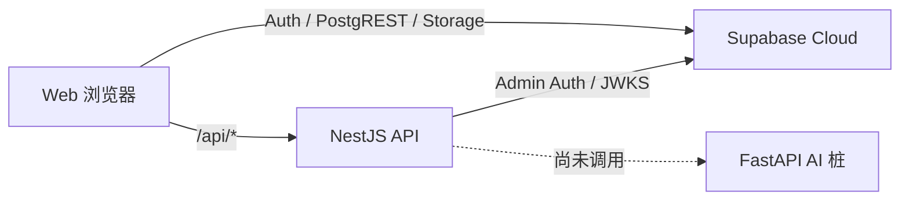

# API 文档

> **本文内容：** 记录当前 NestJS 公网 API、FastAPI 内部桩接口，以及浏览器直接使用的 Supabase Auth/PostgREST/Storage 数据面；同时指出尚未实现的目标 API。  
> **作用：** 为前后端联调、客户端开发、自动化测试、安全评审和接口演进提供明确契约，避免把架构蓝图中的接口误认为已经可用。  
> **何时更新：** 新增/删除/变更路由、请求/响应/状态码、认证授权、数据 schema、Supabase 访问方式、错误码或 API 版本策略时，与实现同一提交更新。

## 1. 当前接口边界



- 生产 Web/API 同源基址：`https://nalanda.online`；本文示例默认本地 `http://localhost:3000`。
- NestJS 全局前缀：`/api`。
- FastAPI 默认本地基址：`http://localhost:8000`，目标上只允许内网访问；当前没有 API→AI 调用代码。
- 当前没有 OpenAPI 文件、API 版本号、请求 ID、统一业务错误 envelope、速率限制或分页规范。
- NestJS 当前 `enableCors()` 使用默认宽松 CORS；生产安全策略尚未收紧。

## 2. 认证约定

### 2.1 浏览器登录链路

1. 注册时浏览器调用 `POST /api/auth/register`；API 用 service-role 调 Supabase Admin Auth 创建已确认用户。
2. 浏览器随后直接调用 `supabase.auth.signInWithPassword` 获取 Supabase session。
3. 访问受保护 NestJS 接口时发送：

```http
Authorization: Bearer <supabase-access-token>
```

4. API 优先从 `<SUPABASE_URL>/auth/v1/.well-known/jwks.json` 获取公钥，校验 issuer 和 `audience=authenticated`；旧 HS256 项目可用 `SUPABASE_JWT_SECRET` 回退。

当前除 `/api/me` 外没有 NestJS 受保护业务接口。Web 的资料库、社区、学习计划、Profile、反馈和通知主要通过 `supabase-js` 直连，授权由数据库 RLS 承担。

### 2.2 错误格式

业务注册错误是包含 `code` 的 JSON。NestJS 框架级错误通常包含 `statusCode`、`message` 和 `error`；调用方不能假定所有错误完全同形。FastAPI 请求校验失败使用其标准 `422` detail 数组。

## 3. NestJS API（当前实现）

### `GET /api/health`

认证：无。  
实现：`apps/api/src/health/health.controller.ts`。

响应 `200`：

```json
{
  "status": "ok",
  "service": "nalanda-api",
  "time": "2026-07-10T00:00:00.000Z",
  "deps": {
    "redis": "unset",
    "ai": "unset",
    "supabase": "configured"
  }
}
```

语义限制：依赖状态只检查对应环境变量是否存在，不会连接 Redis、AI 或 Supabase，也不验证数据库迁移。因此它是 liveness/配置提示，不是完整 readiness。

示例：

```bash
curl -fsS http://localhost:3000/api/health
```

### `POST /api/auth/register`

认证：无。  
Content-Type：`application/json`。  
实现：`apps/api/src/auth/auth.controller.ts`。

请求：

```json
{
  "email": "developer@example.com",
  "password": "at-least-6-characters"
}
```

处理规则：email 去首尾空白并转小写，使用简单邮箱正则；password 最少 6 字符。成功时通过 Supabase Admin API 创建 `email_confirm=true` 的用户。

| HTTP | `code` | 含义 |
|---:|---|---|
| 200 | — | `{ "ok": true }`；只代表创建成功，不返回 session |
| 400 | `INVALID_EMAIL` | 邮箱格式不通过当前正则 |
| 400 | `WEAK_PASSWORD` | 密码少于 6 字符 |
| 400 | `REGISTER_FAILED` | 未归类的 Supabase 注册失败 |
| 409 | `EMAIL_TAKEN` | 邮箱已存在；由状态码或上游文本启发式识别 |
| 500 | `SERVER_MISCONFIG` | API 缺 `SUPABASE_URL` 或 service-role key |
| 502 | `UPSTREAM_UNREACHABLE` | API 无法访问 Supabase Auth |

示例：

```bash
curl -i http://localhost:3000/api/auth/register \
  -H 'Content-Type: application/json' \
  --data '{"email":"developer@example.com","password":"change-me"}'
```

此接口会创建真实账号，不应作为无清理逻辑的普通 smoke test，也不能对生产反复执行。当前没有验证码、速率限制、反滥用或密码强度扩展规则。

### `GET /api/me`

认证：Supabase bearer token。  
实现：`apps/api/src/me/me.controller.ts` 和 `apps/api/src/auth/supabase.guard.ts`。

成功 `200`：

```json
{
  "user": {
    "id": "00000000-0000-0000-0000-000000000000",
    "email": "developer@example.com",
    "role": "authenticated"
  }
}
```

`id` 来自 JWT `sub`；`email`、`role` 可能不存在，因此客户端必须按可选字段处理。该接口不会查询 `profiles`。

失败 `401`：无 token 时 message 为 `Missing bearer token`；验签失败或没有 `sub` 时为 `Invalid token`。

```bash
curl -fsS http://localhost:3000/api/me \
  -H "Authorization: Bearer $SUPABASE_ACCESS_TOKEN"
```

此处 `$SUPABASE_ACCESS_TOKEN` 指用户登录 access token，不是数据库迁移使用的 Supabase Personal Access Token；两者不能混用。

## 4. FastAPI AI（当前桩接口）

实现入口：`apps/ai/app/main.py`；请求模型：`apps/ai/app/schemas.py`。当前所有路由无认证、无限流，所以部署时必须保持内网可达，不能直接暴露公网。

### `GET /health`

响应 `200`：

```json
{
  "status": "ok",
  "service": "nalanda-ai",
  "claude": "unset"
}
```

`claude` 只表示是否设置 `ANTHROPIC_API_KEY`，不验证 key，也不表示生成已接入。

### `POST /parse`

请求：

```json
{
  "storage_path": "<user-id>/example.pdf",
  "material_type": "pdf"
}
```

当前固定响应：

```json
{
  "material_type": "pdf",
  "blocks": [],
  "text": ""
}
```

它不会读取 Storage、下载文件、校验路径所有权或解析文档。

### 生成接口通用请求

以下四个 endpoint 使用相同请求：

```json
{
  "material_id": "00000000-0000-0000-0000-000000000000",
  "text": "source text",
  "lang": "zh"
}
```

| 字段 | 类型 | 必需 | 当前规则 |
|---|---|---|---|
| `material_id` | string | 是 | Pydantic 仅要求字符串，不验证 UUID/存在性/归属 |
| `text` | string | 否 | 默认 `""`；桩实现忽略内容 |
| `lang` | `"zh" | "en"` | 否 | 默认 `"zh"` |

注意：共享 TypeScript `GenerateRequest` 当前使用 `materialId`，Python 请求使用 `material_id`，没有自动转换层；这是接线前必须统一的契约差异。

### `POST /generate/knowledge-list`

响应为数组：

```json
[
  {
    "title": "示例概念",
    "definition": "占位定义，待接入 Claude 生成。",
    "tags": ["stub"],
    "order": 1
  }
]
```

### `POST /generate/quiz`

响应为数组：

```json
[
  {
    "question": "占位题目？",
    "options": ["A", "B", "C", "D"],
    "answerIndex": 1,
    "explanation": "占位解析。",
    "type": "single"
  }
]
```

### `POST /generate/graph`

响应为对象：

```json
{
  "nodes": [
    { "id": "r", "label": "Root", "level": 0 },
    { "id": "a", "label": "A", "level": 1 }
  ],
  "edges": [["r", "a"]]
}
```

### `POST /generate/exam`

响应为对象：

```json
{
  "title": "Mock Exam",
  "meta": "Stub · 100 marks",
  "sections": [
    {
      "name": "Section A",
      "questions": [{ "prompt": "...", "marks": 10 }]
    }
  ]
}
```

本地调用示例：

```bash
curl -fsS http://localhost:8000/generate/quiz \
  -H 'Content-Type: application/json' \
  --data '{"material_id":"demo","text":"hello","lang":"zh"}'
```

## 5. Supabase 数据面（当前实现）

Web 使用 `@supabase/supabase-js`，并由 Supabase 自动映射到 Auth/PostgREST/Storage。这里记录应用实际依赖的能力，而不是承诺固定的原始 REST URL。

### 5.1 Auth

| 客户端操作 | 当前用途 |
|---|---|
| `auth.getSession()` | 初始化登录态、给后端请求获取 access token |
| `auth.onAuthStateChange()` | session 切换后进入/退出应用 |
| `auth.signInWithPassword()` | 注册完成后的自动登录和普通登录 |
| `auth.signOut()` | 退出 |

当前没有 OAuth、重置密码、MFA、账号导出/删除的应用接口。

### 5.2 PostgREST 表能力

| 领域 | 表 | Web 当前使用的主要操作 | 授权边界摘要 |
|---|---|---|---|
| 个人资料 | `profiles` | 本人 select/update | 当前 own update 可写整行，服务端字段尚未隔离 |
| 资料库 | `courses`, `materials` | owner CRUD | materials 写入额外校验课程 owner |
| 通知 | `notifications` | owner select/insert/update | 用户可标已读；当前 policy 也允许改其它 own 字段 |
| 反馈 | `feedback` | owner select/insert | policy 实际允许 owner 全 CRUD |
| 社区 | `posts`, `comments` | 公共读取；作者写/删 | “公共”指 authenticated 用户，不是匿名互联网 |
| 社区关系 | `post_likes`, `post_favorites`, `follows` | 当前用户增删/查询关系 | 复合主键防同时重复关系 |
| 标签 | `tags` | authenticated 读/插入 | 无更新/删除；无 kind 白名单约束 |
| 计划 | `study_goals`, `study_tasks` | owner CRUD | task 关联实体由 RLS 检查 owner |

字段、FK、级联和完整 RLS 矩阵见 [ERD 与数据库字典](./ERD.md)。Web 不应使用 service-role key；所有直连请求都必须在 anon key + 用户 session + RLS 下运行。

### 5.3 Storage

| Bucket | 当前调用 | URL/时效 |
|---|---|---|
| `materials`（private） | upload、remove、createSignedUrl | 下载签名 URL 120 秒；预览签名 URL 600 秒；路径首段为用户 UUID |
| `community-media`（public） | upload、getPublicUrl | 公开长期 URL；路径首段为用户 UUID |

表行与 Storage 对象不是同一事务。资料上传在表插入失败时尝试删除对象，但进程/网络中断仍可能产生孤儿；删除帖子也不会自动删除社区媒体。

### 5.4 数据库函数/RPC 暴露面

前端当前没有显式调用 `rpc()`。不过 `public` schema 的函数可能由 PostgREST 暴露；`_add_points`、`_notify` 等 `SECURITY DEFINER` 函数当前迁移没有显式收回默认 EXECUTE。应在安全迁移中撤权，并为确需客户端调用的 RPC 建立窄参数、调用者绑定和幂等检查。

## 6. 尚未实现的目标 API

以下能力属于最终产品路线，不是当前可调用接口：

- 资料解析、AI 生成任务提交/排队/状态/取消/重试；
- 笔记与四类生成产物的版本化 CRUD；
- 市场发布、购买、授权、搜索和创作者结算；
- points/credits 不可变账本、余额、VIP entitlement；
- Stripe checkout/payment intent/webhook/refund；
- 内容举报、审核、管理员处置与申诉；
- 用户数据导出、删除请求与进度；
- Realtime 通知、设备推送；
- 管理、审计、监控和内部运维 API。

目标 API 落地前必须先确定版本策略、鉴权/角色、幂等键、分页、统一错误码、审计、限流、OpenAPI 与契约测试；不能仅按蓝图路由名直接上线。

## 7. 接口变更检查清单

1. 更新实现、共享类型与本文，避免 snake_case/camelCase 漂移。
2. 为新增 endpoint 明确认证、授权、输入上限、错误码和日志脱敏。
3. 增加单元/契约/E2E 测试，命令见 [测试指南](./TESTING.md)。
4. 数据结构变化先走向后兼容迁移，见 [数据库发布与回滚](../operations/DATABASE_RELEASE_ROLLBACK.md)。
5. 公网接口进行速率限制和滥用评审；内部接口也需网络隔离与服务认证。
6. 涉及 key 或新供应商时同步更新[环境变量矩阵](./ENVIRONMENT_VARIABLES.md)和[密钥轮换](../operations/SECRET_ROTATION.md)。
