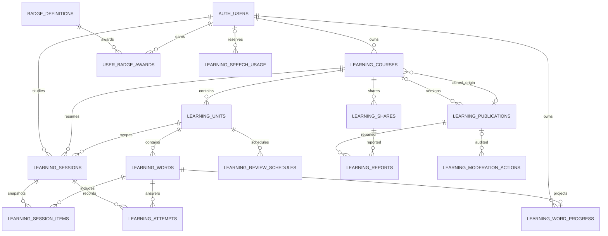

# ERD 与数据库字典

> **本文内容：** 描述当前 Supabase/PostgreSQL 中全部应用表、字段、关系、删除行为、RLS、Storage 桶、触发器与数据库函数，并单列尚未实现的目标实体。  
> **作用：** 作为数据库结构评审、接口开发、迁移编写、安全审计和数据恢复时的共同事实来源。  
> **何时更新：** 每次新增或修改迁移、表/列/约束/索引/RLS/函数/触发器/Storage 策略时与代码同一个变更提交更新；目标模型转为真实迁移时也要更新状态。

## 1. 权威来源与范围

本页按 `supabase/migrations/20260620000001_profiles.sql` 至 `20260723000014_learning_feedback_flow.sql` 的最终叠加结果整理。迁移 SQL 是结构的最终权威来源；本文用于阅读和评审。仓库与生产 migration history 均已通过受保护 plan/apply 同步到 0014。

- **仓库最终结构**：30 张 `public` 业务/配置表、`auth.users` 外部身份表、3 个 Storage bucket，以及相关 RLS/函数/触发器。
- **未实现目标**：AI 笔记产物/文件导入、通用市场、credits 钱包账本、订单/支付、订阅/VIP 权益、社区审核与通用审计等实体。Courses 已有专用举报/审核事实，不能把它描述成全站治理已完成。

## 2. 当前 ERD

```mermaid
erDiagram
    AUTH_USERS {
        uuid id PK
        text email
    }
    PROFILES {
        uuid id PK_FK
        text username
        text email
        text university
        text major
        text year
        text language
        text timezone
        integer credits
        integer points
        integer level
        text level_name
        timestamptz vip_until
        integer streak
        date streak_date
        timestamptz created_at
        timestamptz updated_at
    }
    COURSES {
        uuid id PK
        uuid user_id FK
        text code
        text name
        text color
        text term
        text instructor
        timestamptz created_at
    }
    MATERIALS {
        uuid id PK
        uuid user_id FK
        uuid course_id FK
        text name
        text type
        bigint size_bytes
        text storage_path
        timestamptz created_at
    }
    NOTIFICATIONS {
        uuid id PK
        uuid user_id FK
        text type
        text title
        text body
        boolean read
        timestamptz created_at
    }
    FEEDBACK {
        uuid id PK
        uuid user_id FK
        text category
        text summary
        text body
        text status
        timestamptz created_at
    }
    POSTS {
        uuid id PK
        uuid user_id FK
        uuid repost_of FK
        text author_name
        text author_university
        text author_major
        text title
        text body
        text kind
        text subject
        text_array tags
        text image_url
        text audio_url
        text points_business_key
        integer like_count
        integer comment_count
        integer favorite_count
        integer repost_count
        timestamptz created_at
        timestamptz updated_at
    }
    COMMENTS {
        uuid id PK
        uuid post_id FK
        uuid user_id FK
        text author_name
        text body
        text points_business_key
        timestamptz created_at
    }
    POST_LIKES {
        uuid post_id PK_FK
        uuid user_id PK_FK
        text points_business_key
        timestamptz created_at
    }
    POST_FAVORITES {
        uuid post_id PK_FK
        uuid user_id PK_FK
        timestamptz created_at
    }
    FOLLOWS {
        uuid follower_id PK_FK
        uuid following_id PK_FK
        timestamptz created_at
    }
    TAGS {
        text kind PK
        text value PK
        timestamptz created_at
    }
    STUDY_GOALS {
        uuid id PK
        uuid user_id FK
        uuid course_id FK
        text title
        date exam_date
        timestamptz created_at
    }
    STUDY_TASKS {
        uuid id PK
        uuid user_id FK
        uuid course_id FK
        uuid material_id FK
        uuid goal_id FK
        text title
        date due_date
        boolean done
        timestamptz done_at
        text points_business_key
        timestamptz created_at
    }
    POINT_ENTRIES {
        bigint id PK
        uuid user_id FK
        text event_type
        text business_key
        integer amount
        text rule_version
        uuid source_id
        integer transition_no
        bigint reversal_of FK
        jsonb metadata
        timestamptz created_at
    }
    POINT_EVENT_STATES {
        text business_key PK
        uuid user_id FK
        text event_type
        integer reward_amount
        boolean is_active
        integer transition_no
        uuid source_id
        bigint last_entry_id FK
        jsonb metadata
        timestamptz created_at
        timestamptz updated_at
    }

    AUTH_USERS ||--o| PROFILES : "id"
    AUTH_USERS ||--o{ COURSES : "owns"
    AUTH_USERS ||--o{ MATERIALS : "owns"
    AUTH_USERS ||--o{ NOTIFICATIONS : "receives"
    AUTH_USERS ||--o{ FEEDBACK : "submits"
    AUTH_USERS ||--o{ POSTS : "authors"
    AUTH_USERS ||--o{ COMMENTS : "authors"
    AUTH_USERS ||--o{ POST_LIKES : "likes"
    AUTH_USERS ||--o{ POST_FAVORITES : "favorites"
    AUTH_USERS ||--o{ FOLLOWS : "follower"
    AUTH_USERS ||--o{ FOLLOWS : "following"
    AUTH_USERS ||--o{ STUDY_GOALS : "owns"
    AUTH_USERS ||--o{ STUDY_TASKS : "owns"
    AUTH_USERS ||--o{ POINT_ENTRIES : "owns ledger"
    AUTH_USERS ||--o{ POINT_EVENT_STATES : "owns event state"
    COURSES ||--o{ MATERIALS : "contains"
    COURSES o|--o{ STUDY_GOALS : "optionally groups"
    COURSES o|--o{ STUDY_TASKS : "optionally groups"
    MATERIALS o|--o{ STUDY_TASKS : "optionally links"
    STUDY_GOALS o|--o{ STUDY_TASKS : "optionally contains"
    POSTS o|--o{ POSTS : "reposted by"
    POSTS ||--o{ COMMENTS : "has"
    POSTS ||--o{ POST_LIKES : "has"
    POSTS ||--o{ POST_FAVORITES : "has"
    POINT_ENTRIES o|--o{ POINT_ENTRIES : "previous transition"
    POINT_ENTRIES o|--o| POINT_EVENT_STATES : "last entry"
```

`auth.users` 由 Supabase Auth 管理；图中只展示应用实际引用的 `id` 和概念性 `email`，不是对 Auth 内部表的完整定义。

### 2.1 Courses 子域 ERD



`learning_attempts` 是追加事实，`learning_word_progress` 是受保护投影；市场 publication 是不可变快照，source 课程删除时只把 `source_course_id` 置空。分享读取当前课程，不保存内容副本。

## 3. 表字典

### 3.1 `profiles`

与 `auth.users` 共享主键，注册后的 `handle_new_user` 触发器负责创建。`points`/等级用于活动成长：`points` 是 `point_entries` 的缓存投影，等级由该投影计算；`credits` 仍只是尚无钱包账本的预留数值。普通 authenticated 用户只能更新资料白名单列，不能更新 points、credits、等级、VIP 或 streak。

| 列 | 类型 | 空值/默认 | 关系或说明 |
|---|---|---|---|
| `id` | `uuid` | PK，非空 | → `auth.users.id ON DELETE CASCADE` |
| `username` | `text` | 可空 | 默认建档时取邮箱 `@` 前部分 |
| `email` | `text` | 可空 | Auth 邮箱快照，不是认证权威字段 |
| `university`, `major`, `year` | `text` | 可空 | 用户资料 |
| `language` | `text` | 非空，`'zh'` | 当前无 check constraint |
| `timezone` | `text` | 非空，`'UTC'` | 0011 增加；插入/更新 trigger 必须在 `pg_timezone_names` 中存在，历史 attempt `local_date` 不随修改重写 |
| `credits` | `integer` | 非空，`0` | 尚无钱包账本/支付闭环 |
| `points` | `integer` | 非空，`0` | 迁移 0006 增加；0008 起由 ledger 总和投影并 clamp 到 `0..2147483647` |
| `level` | `integer` | 非空，`1` | `_set_point_event` 根据 points 投影计算 |
| `level_name` | `text` | 非空，`'Novice'` | `_set_point_event` 根据 points 投影计算 |
| `vip_until` | `timestamptz` | 可空 | 尚无订阅/支付写入规则 |
| `streak` | `integer` | 非空，`0` | 迁移 0007 增加 |
| `streak_date` | `date` | 可空 | 最近一次计入连续学习的日期 |
| `created_at`, `updated_at` | `timestamptz` | 非空，`now()` | `profiles_touch` 更新 `updated_at` |

### 3.2 `courses` 与 `materials`

| 表 | 列 | 类型 | 空值/默认 | 关系或说明 |
|---|---|---|---|---|
| `courses` | `id` | `uuid` | PK，`gen_random_uuid()` | — |
|  | `user_id` | `uuid` | 非空，`auth.uid()` | → `auth.users.id CASCADE` |
|  | `code` | `text` | 可空 | 课程代码 |
|  | `name` | `text` | 非空 | — |
|  | `color` | `text` | 非空，`'#9c6a39'` | — |
|  | `term`, `instructor` | `text` | 可空 | — |
|  | `created_at` | `timestamptz` | 非空，`now()` | — |
| `materials` | `id` | `uuid` | PK，`gen_random_uuid()` | — |
|  | `user_id` | `uuid` | 非空，`auth.uid()` | → `auth.users.id CASCADE` |
|  | `course_id` | `uuid` | 非空 | → `courses.id CASCADE`；RLS 还检查课程归属 |
|  | `name` | `text` | 非空 | — |
|  | `type` | `text` | 可空 | 当前无格式枚举约束 |
|  | `size_bytes` | `bigint` | 非空，`0` | — |
|  | `storage_path` | `text` | 非空 | 指向 `materials` bucket 的逻辑路径，无数据库 FK |
|  | `created_at` | `timestamptz` | 非空，`now()` | — |

索引：`materials(course_id)`。

### 3.3 `notifications` 与 `feedback`

| 表 | 列 | 类型 | 空值/默认 | 说明 |
|---|---|---|---|---|
| `notifications` | `id` | `uuid` | PK，`gen_random_uuid()` | — |
|  | `user_id` | `uuid` | 非空，`auth.uid()` | → `auth.users.id CASCADE` |
|  | `type` | `text` | 可空 | 如 `like/comment/favorite/repost/follow/streak`，无 check |
|  | `title` | `text` | 非空 | — |
|  | `body` | `text` | 可空 | — |
|  | `read` | `boolean` | 非空，`false` | — |
|  | `created_at` | `timestamptz` | 非空，`now()` | 索引 `(user_id, created_at DESC)` |
| `feedback` | `id` | `uuid` | PK，`gen_random_uuid()` | — |
|  | `user_id` | `uuid` | 非空，`auth.uid()` | → `auth.users.id CASCADE` |
|  | `category` | `text` | 可空 | — |
|  | `summary` | `text` | 非空 | — |
|  | `body` | `text` | 可空 | — |
|  | `status` | `text` | 非空，`'open'` | 当前用户可通过 own policy 更新，尚无服务端状态机 |
|  | `created_at` | `timestamptz` | 非空，`now()` | 索引 `(user_id, created_at DESC)` |

### 3.4 社区表

#### `posts`

| 列 | 类型 | 空值/默认 | 说明 |
|---|---|---|---|
| `id` | `uuid` | PK，`gen_random_uuid()` | — |
| `user_id` | `uuid` | 非空，`auth.uid()` | → `auth.users.id CASCADE` |
| `author_name`, `author_university`, `author_major` | `text` | 可空 | 插入时由 `_post_author` 从 profile 覆盖为快照 |
| `title`, `body` | `text` | 可空 | 数据库未要求至少一个非空 |
| `kind` | `text` | 非空，`'experience'` | 注释约定 experience/question/tip/note_share，无 check |
| `subject` | `text` | 可空 | 非 FK 的课程/学科文本 |
| `tags` | `text[]` | 非空，`'{}'` | 不与 `tags` 表做 FK |
| `repost_of` | `uuid` | 可空 | → `posts.id CASCADE`；原帖删除会级联删除转发帖 |
| `image_url`, `audio_url` | `text` | 可空 | 通常是公开 bucket URL，无 FK/所有权校验 |
| `points_business_key` | `text` | 非空 | 0008 增加；原创按 owner + 规范化内容生成，转发按 actor + 根原创内容键生成，且与 `repost_of` 一并不可变 |
| `like_count`, `comment_count`, `favorite_count`, `repost_count` | `int` | 非空，`0` | 触发器维护的冗余计数 |
| `created_at`, `updated_at` | `timestamptz` | 非空，`now()` | posts 没有自动 touch trigger，前端编辑时自行写 `updated_at` |

索引：`created_at DESC`、`user_id`、`subject`、`points_business_key`。

#### 互动与关系

| 表 | 主键 | 其它列/关系 | 删除行为 |
|---|---|---|---|
| `comments` | `id uuid` | `post_id → posts`、`user_id → auth.users`、`author_name` 快照、`body NOT NULL`、`points_business_key NOT NULL`、`created_at` | post/user 均 CASCADE；points key 锚定目标帖不可变内容键 + actor；索引 `(post_id, created_at)` 与 points key |
| `post_likes` | `(post_id,user_id)` | `points_business_key NOT NULL`、`created_at` | post/user 均 CASCADE；points key 锚定目标帖不可变内容键 + actor；同逻辑内容重复帖共用奖励 claim |
| `post_favorites` | `(post_id,user_id)` | `created_at` | post/user 均 CASCADE；唯一主键防止同时保留重复收藏 |
| `follows` | `(follower_id,following_id)` | 二者均 → `auth.users`，`created_at` | user CASCADE；当前没有 `follower_id <> following_id` check |
| `tags` | `(kind,value)` | `created_at` | 独立全局字典，无 FK；kind 注释约定 university/major/subject/tag，无 check |

### 3.5 学习计划

| 表 | 列 | 类型 | 空值/默认 | 关系或说明 |
|---|---|---|---|---|
| `study_goals` | `id` | `uuid` | PK，`gen_random_uuid()` | — |
|  | `user_id` | `uuid` | 非空，`auth.uid()` | → `auth.users.id CASCADE` |
|  | `title` | `text` | 非空 | — |
|  | `exam_date` | `date` | 可空 | — |
|  | `course_id` | `uuid` | 可空 | → `courses.id ON DELETE SET NULL` |
|  | `created_at` | `timestamptz` | 非空，`now()` | — |
| `study_tasks` | `id` | `uuid` | PK，`gen_random_uuid()` | — |
|  | `user_id` | `uuid` | 非空，`auth.uid()` | → `auth.users.id CASCADE` |
|  | `title` | `text` | 非空 | — |
|  | `due_date` | `date` | 非空，`current_date` | 索引 `(user_id,due_date)` |
|  | `done` | `boolean` | 非空，`false` | 任何 done 更新进入幂等状态机；首次完成激活 points/streak，取消会冲正 points |
|  | `done_at` | `timestamptz` | 可空 | 当前数据库不强制与 `done` 一致 |
|  | `points_business_key` | `text` | 非空 | 0008 增加；插入时按 owner、规范化标题、日期和关联实体生成，之后不可变 |
|  | `course_id` | `uuid` | 可空 | → `courses.id SET NULL`；RLS 校验 owner |
|  | `material_id` | `uuid` | 可空 | → `materials.id SET NULL`；RLS 校验 owner |
|  | `goal_id` | `uuid` | 可空 | → `study_goals.id SET NULL`；RLS 校验 owner |
|  | `created_at` | `timestamptz` | 非空，`now()` | — |

`study_goals` 的当前 RLS 只校验 goal 的 `user_id`，没有像 `study_tasks` 一样检查可选 `course_id` 的归属；这是应在后续安全迁移中收紧的边界。

### 3.6 Points 账本与事件状态

`point_entries` 是当前 points 的追加式分录，`point_event_states` 是只供数据库内部使用的业务事件状态机。迁移 0008 先把旧 `profiles.points` 写为一条 `legacy_opening`，再把已有帖子、评论关系、点赞和已完成任务登记为 `transition_no=0` 的 active 状态，不重复加分；0009 为每条 opening 追加 `legacy_opening_reset` reversal，并重建 Profile 投影。

| 表 | 列 | 类型/约束 | 说明 |
|---|---|---|---|
| `point_entries` | `id` | `bigint identity` PK | 分录 ID |
|  | `user_id` | `uuid NOT NULL` | → `auth.users.id CASCADE`；authenticated 仅能读取自己的分录 |
|  | `event_type` | `text NOT NULL` | `legacy_opening/legacy_opening_reset/post_created/repost_created/like_created/comment_created/task_completed` 等 |
|  | `business_key` | `text NOT NULL` | 永久业务键；与 `transition_no` 组成唯一约束 |
|  | `amount` | `integer NOT NULL, <> 0` | 激活为正、取消/删除冲正为负 |
|  | `rule_version` | `text NOT NULL` | 当前新事件为 `points-v1`；opening 为 `legacy-import-v1` |
|  | `source_id` | `uuid` 可空 | 触发该 transition 的当前源记录，不做 FK，源删除后分录仍保留 |
|  | `transition_no` | `integer >= 0` | opening 为 0；同一业务键后续严格递增 |
|  | `reversal_of` | `bigint` 可空 | → 前一条 `point_entries.id ON DELETE NO ACTION`，形成 transition 链 |
|  | `metadata` | `jsonb NOT NULL` | 源对象与迁移/active 信息 |
|  | `created_at` | `timestamptz NOT NULL` | 默认 `now()` |
| `point_event_states` | `business_key` | `text` PK | 每个永久业务事件一行 |
|  | `user_id` | `uuid NOT NULL` | → `auth.users.id CASCADE` |
|  | `event_type`, `reward_amount` | 非空 | 键碰撞时类型/用户/奖励必须一致，否则事务失败 |
|  | `is_active`, `transition_no` | 非空 | 当前净状态及最新 transition |
|  | `source_id`, `last_entry_id` | 可空 | 当前源记录；最新分录引用为 `ON DELETE NO ACTION` |
|  | `metadata`, `created_at`, `updated_at` | 非空 | 内部状态与审计时间 |

状态转换通过 `_set_point_event` 的 advisory lock、profile 行锁、状态行锁和唯一键串行化。点赞与评论按 actor + 目标帖不可变内容键、转发按 actor + 根原创内容键、原创帖按 owner + 规范化内容、任务按 owner + 规范化任务指纹去重。相同内容的重复帖子及删除后重建会复用 claim。取消/删除写负分录，重做写正分录，净额不会随循环操作累计；任务只有首次激活 `transition=1` 会推进 streak。

历史边界：0008 无法判断旧宽松权限期间的 `profiles.points/credits/vip/streak` 是否曾被人为篡改。opening 只保存迁移事实，不代表余额可信；0009 根据已记录的产品/安全决定追加 reversal 归零，不删除原记录。credits/VIP 仍没有可重建账本。

### 3.7 Courses 内容、学习、传播与成长

以下列清单覆盖 0011 的全部新增表。`uuid` 默认均为 `gen_random_uuid()`（复合键/identity 除外），时间列未特别注明时默认 `now()`。

| 表 | 全部列 | 关键约束与关系 |
|---|---|---|
| `learning_courses` | `id`, `user_id`, `title`, `category`, `has_units`, `locale`, `origin_publication_id`, `origin_share_id`, `origin_author_name`, `can_republish`, `points_claimed_at`, `created_at`, `updated_at` | owner → Auth CASCADE；标题 1–80；四类 category 但 v1 API 只接受英语词表；locale=`en-US`；`(id,user_id)` 唯一；克隆来源 → publication/share SET NULL，来源记录消失后仍保留作者署名 |
| `learning_course_units` | `id`, `course_id`, `user_id`, `name`, `position`, `is_system`, `created_at`, `updated_at` | course/Auth CASCADE；复合 FK `(course_id,user_id)` 防跨 owner；名 1–80；position≥0；`(course_id,position)` 延迟唯一 |
| `learning_course_words` | `id`, `course_id`, `unit_id`, `user_id`, `term`, `normalized_term`, `translations`, `ipa`, `position`, `content_version`, `created_at`, `updated_at` | `normalized_term` 为 `_points_normalize_text(term)` stored generated；term 1–120；1–10 translations；IPA≤120；复合 unit/course/owner FK；单元内 normalized term 与 position 延迟唯一 |
| `learning_sessions` | `id`, `user_id`, `course_id`, `unit_id`, `mode`, `scope`, `selected_skills`, `stage`, `active`, `state`, `started_at`, `last_activity_at`, `completed_at` | course CASCADE、unit 删除 SET NULL；mode=`initial/review`；scope=`all/unlearned`；skill 为 pronunciation/translation/spelling 的 1–3 项；stage 为 recognition/pronunciation/translation/spelling/completed；每用户每课程最多一个 active 会话 |
| `learning_session_items` | `session_id`, `word_id`, `position`, `recognition_seen`, `pronunciation_passed`, `translation_passed`, `spelling_passed`, `wrong_count` | `(session_id,word_id)` PK；会话/词删除 CASCADE；position 每会话延迟唯一；pass 字段是当前会话投影 |
| `learning_attempts` | `id`, `user_id`, `course_id`, `session_id`, `word_id`, `mode`, `skill`, `is_correct`, `answer`, `error_kind`, `provider_details`, `local_date`, `created_at` | bigint identity；course/session/user CASCADE，word 删除 SET NULL；skill 另含 recognition 和 speech_assessment；允许 `is_correct=null` 表达非判分事实；保存发生时本地日期，不保存录音；service_role 也无直接 UPDATE/DELETE，普通内容编辑不会删历史 attempt，课程删除仍按产品规则级联 |
| `learning_word_progress` | `user_id`, `word_id`, `initial_recognition_seen`, `initial_pronunciation_passed`, `initial_translation_passed`, `initial_spelling_passed`, `pronunciation_review_dates`, `translation_review_dates`, `spelling_review_dates`, `wrong_count`, `review_count`, `learned_at`, `updated_at` | `(user_id,word_id)` PK；三组 date[] 去重由工作流保证；三项均有至少两个不同完成复习日期才设置 learned_at |
| `learning_review_schedules` | `id`, `user_id`, `course_id`, `unit_id`, `source_session_id`, `due_date`, `skills`, `scope`, `status`, `completed_session_id`, `completed_at`, `created_at` | user/course/unit/source initial session CASCADE，completed review session SET NULL；只有本人该单元已完成 initial session 才能创建 3/7/15/30 偏移；status=`pending/completed/cancelled`；`(user_id,unit_id,due_date)` 唯一 |
| `learning_speech_usage` | `id`, `user_id`, `kind`, `cost_microusd`, `local_date`, `created_at` | bigint identity；user 删除 SET NULL 以保留预算事实；kind=`tts/assessment`；成本必须 >0；没有音频/参考文本 |
| `learning_course_shares` | `id`, `user_id`, `course_id`, `token_hash`, `active`, `author_name`, `created_at`, `revoked_at` | owner/course CASCADE；只存 token SHA-256；token hash 唯一，每课程最多一个 active 分享 |
| `learning_course_publications` | `id`, `author_id`, `source_course_id`, `title`, `description`, `author_name`, `category`, `locale`, `version`, `snapshot`, `content_fingerprint`, `status`, `rights_declared_at`, `clone_count`, `created_at`, `updated_at` | author CASCADE、source SET NULL；英语/en-US；status=`published/hidden/withdrawn`；同 author/source/version 唯一；trigger 禁止内容快照/署名/指纹/权利声明变更，只允许生命周期、clone_count、source 置空和 updated_at |
| `learning_course_reports` | `id`, `reporter_id`, `publication_id`, `share_id`, `category`, `details`, `status`, `created_at` | reporter CASCADE，目标 CASCADE；publication/share 必须且只能有一个；六类举报；details≤1000；status=`open/reviewing/resolved/dismissed` |
| `learning_course_moderation_actions` | `id`, `publication_id`, `actor_id`, `action`, `reason`, `created_at` | bigint identity；publication/actor 删除 SET NULL，审计行保留；action=`hide/restore/withdraw`；reason 1–1000 |
| `badge_definitions` | `code`, `family`, `tier`, `name`, `description`, `threshold`, `icon` | code PK；family+tier 唯一；tier 1–3；0011 固定种入 vocab_words/vocab_courses/vocab_review_days 共九级 |
| `user_badge_awards` | `user_id`, `badge_code`, `awarded_at`, `metadata` | 复合 PK；user CASCADE；badge definition DELETE RESTRICT；`ON CONFLICT DO NOTHING` 保证历史只发一次 |

内容保存约束由单个 `learning_upsert_course` 事务补充：课程 4–2,000 个不同规范化词/短语、最多 100 单元、每词翻译非空且去重。数据库可存四类 category 是为兼容未来，但当前 API/UI 明确拒绝非 `english_vocabulary`。

## 4. 删除与生命周期规则

| 父实体删除 | 当前结果 |
|---|---|
| `auth.users` | 级联删除 profile、资料课程、私有学习课程/会话/尝试/progress/日程/分享、本人出版物/举报和 badge awards；points 分录/事件状态也级联。speech usage/moderation actor 改为 NULL。Storage 文件是否删除不由 FK 保证。 |
| `courses` | 资料 CASCADE；目标/任务的 `course_id` SET NULL。 |
| `materials` | 任务的 `material_id` SET NULL；Storage 对象不会由表 FK 自动删除。 |
| `study_goals` | 任务的 `goal_id` SET NULL。 |
| `posts` | 评论/点赞/收藏 CASCADE；引用它的转发帖也 CASCADE；相关 active points 事件会按 trigger 冲正。媒体对象不会自动删除。 |
| `learning_courses` | 单元、词、会话、尝试、progress、复习日程和源课分享级联；publication 的 source SET NULL，克隆课的 `origin_share_id` 随被删分享 SET NULL。已发 points 分录没有 source FK，不删除；用户徽章也不因删课程回退。 |
| `learning_course_shares` | 来源克隆课的 `origin_share_id` SET NULL；针对该分享的举报 CASCADE。 |
| `learning_course_units/words/sessions` | 下游词、session items、attempts/progress 按 FK 级联；删除只能通过课程事务 API，客户端不能直接执行。 |
| `learning_course_publications` | 来源克隆课的 `origin_publication_id` SET NULL；举报 CASCADE；审核动作 publication_id SET NULL 保留。 |
| `learning_course_shares` | 关联举报 CASCADE；撤销通常只写 `active=false/revoked_at` 而不删除。 |

双用户 RLS E2E 在清理阶段验证 Auth 删除后的关系表级联；仓库仍没有生产级账号删除编排来先清理 Storage 对象、导出/冷却或生成删除凭证，因此完整隐私删除流程仍须单独实现。

## 5. RLS 矩阵

所有当前业务表都启用了 RLS。

| 表 | SELECT | INSERT | UPDATE | DELETE |
|---|---|---|---|---|
| `profiles` | 本人 | 无客户端 policy（由 Auth trigger 建档） | 本人仅 `username/university/major/year/language/timezone`；受保护列由 grant + trigger 双重禁止 | 无客户端 policy |
| `courses` | owner | owner | owner | owner |
| `materials` | owner | owner + 关联课程 owner | owner + 关联课程 owner | owner |
| `notifications` | owner | owner | owner | owner |
| `feedback` | owner | owner | owner | owner |
| `posts` | 所有 authenticated | 作者 | 作者 | 作者 |
| `comments` | 所有 authenticated | 作者 | 无 policy | 作者 |
| `post_likes`, `post_favorites` | 仅自己的关系行 | 自己 | 自己 | 自己 |
| `follows` | follower 或 following 是自己 | follower 是自己 | 无 policy | follower 是自己 |
| `tags` | 所有 authenticated | 任意 authenticated | 无 policy | 无 policy |
| `study_goals` | owner | owner | owner | owner |
| `study_tasks` | owner | owner + 所有关联实体 owner | 同左 | owner |
| `point_entries` | 本人 | 无客户端权限/policy | 无客户端权限/policy | 无客户端权限/policy |
| `point_event_states` | 无客户端权限/policy | 无 | 无 | 无 |
| `learning_courses/units/words` | owner | 无 | 无 | 无 |
| `learning_sessions/items/attempts/progress/review_schedules` | owner（items 经 session） | 无 | 无 | 无 |
| `learning_course_shares` | owner | 无 | 无 | 无 |
| `learning_course_publications` | 仅 author 自己 | 无 | 无 | 无 |
| `learning_course_reports` | 仅 reporter 自己 | 无 | 无 | 无 |
| `learning_speech_usage`, `learning_course_moderation_actions` | 无客户端读取 | 无 | 无 | 无 |
| `badge_definitions` | 所有 authenticated | 无 | 无 | 无 |
| `user_badge_awards` | 本人 | 无 | 无 | 无 |

迁移 0008 已修复 Profile 整行更新缺口：表级 UPDATE 从 authenticated 撤销后只授予资料列；0011 只额外授予合法 `timezone`。Courses 表虽然有 owner SELECT policy，但 authenticated 的 INSERT/UPDATE/DELETE 表权限全部撤销；所有公开读取也不靠匿名 RLS。剩余旧模块边界是 `notifications`/`feedback` 的 `for all` owner policy 仍允许 owner 改写部分服务端字段，帖子作者列级白名单也不完整。

## 6. Storage 模型

| Bucket | 可见性 | 当前对象策略 | 路径约定 | 关系边界 |
|---|---|---|---|---|
| `materials` | private | authenticated 仅可 SELECT/INSERT/DELETE 自己 UUID 首段路径 | `{auth.uid()}/...` | `materials.storage_path` 是文本引用；表和对象间无 FK/事务 |
| `community-media` | public | authenticated 仅可 INSERT/DELETE 自己 UUID 首段路径；公共读取由 public bucket 提供 | `{auth.uid()}/...` | `posts.image_url/audio_url` 是 URL 文本；删除帖子不会自动删对象 |
| `vocabulary-audio` | private | 没有客户端 Storage policy；仅 API service-role 读写 | 规范化英文的服务端缓存键 | 只允许 Azure 合成公共语音；不存用户录音，也不与 word 行做 FK |

Storage 策略没有对象 UPDATE policy。涉及替换文件时应使用新路径或显式设计安全策略。

## 7. 函数与触发器

| 函数/触发器 | 事件 | 当前作用 |
|---|---|---|
| `handle_new_user` / `on_auth_user_created` | `auth.users AFTER INSERT` | 创建 profile |
| `touch_updated_at` / `profiles_touch` | `profiles BEFORE UPDATE` | 更新时间戳 |
| `_post_author` / `posts_author` | post BEFORE INSERT | 从 profile 覆盖作者快照 |
| `_comment_author` / `comments_author` | comment BEFORE INSERT | 从 profile 覆盖作者名 |
| `_bump_counts` / `likes_cnt`,`favs_cnt`,`comments_cnt` | 互动 INSERT/DELETE | 维护帖子冗余计数 |
| `_bump_repost` / `repost_cnt` | post INSERT/DELETE | 维护原帖转发计数 |
| `_sync_profile_tags` / `profiles_tags` | profile INSERT/相关 UPDATE | 收集大学/专业全局标签 |
| `_sync_course_tags` / `courses_tags` | course INSERT | 收集 subject 标签 |
| `_add_points` | 已停用的旧 helper | 不再被业务触发器使用，PUBLIC/anon/authenticated/service_role EXECUTE 均已撤销 |
| `_notify` | 被其它函数调用 | 插入通知 |
| `_set_point_event` | 内部状态转换 | 以业务键写分录/状态、重算 points/等级；客户端无 EXECUTE，service_role 可通过受信 RPC 调用 |
| `_post_points_key`、`_root_post_points_key`、`_task_points_key` 与 assign/preserve triggers | post/like/comment/task INSERT 与受保护 UPDATE | 生成并冻结内容锚定业务键；post 的 `repost_of` 与互动 identity 同时冻结 |
| `_guard_profile_managed_fields` | profile BEFORE UPDATE | 防止普通 JWT 角色修改经济、等级、VIP、streak 字段 |
| `_on_like` / `likes_award` | like AFTER INSERT/DELETE | 非自赞首次激活 +1；删除冲正；通知帖主 |
| `_on_comment` / `comments_award` | comment AFTER INSERT/DELETE | 非自评 actor/post 关系 +2；最后一条删除冲正；通知帖主 |
| `_on_fav` / `favs_notify` | favorite AFTER INSERT | 通知帖主 |
| `_on_post` / `posts_award` | post AFTER INSERT/DELETE | 原创 +10 / 转发 +3；最后一个同业务键删除时冲正，并按需通知 |
| `_on_follow` / `follows_notify` | follow AFTER INSERT | 通知被关注者 |
| `_on_task_done` / `task_points_update`,`task_points_delete` | task `done` AFTER UPDATE 或 DELETE | 首次完成 +5；取消/最后一个同键任务删除冲正；仅首次激活更新 streak |
| `_guard_profile_timezone` / `profiles_guard_timezone`、`profiles_guard_timezone_insert` | profile BEFORE INSERT / timezone BEFORE UPDATE | 只接受 PostgreSQL `pg_timezone_names` 中的 IANA 名称 |
| `_guard_learning_publication_snapshot` / `learning_publications_preserve_snapshot` | publication BEFORE UPDATE | 阻止已发布版本内容、署名、指纹和权利声明被改写 |
| `_learning_local_date`, `_learning_course_fingerprint`, `_learning_course_snapshot` | Courses helper | 固化尝试本地日期、词集合 SHA-256 与服务端内部课程快照；公开 API 另经 `publicSnapshot` 删除私有 ID/进度 |
| `_refresh_learning_growth` | 完成学习/复习 | 发放课程 +20 points 和九级徽章；持久业务键/award PK 防重复 |
| `learning_upsert_course`, `learning_rename_course`, `learning_delete_course` | API RPC | owner 校验下原子保存、精确能力重置、改名和级联删除 |
| `learning_start_session`, `learning_mark_recognition`, `learning_record_attempt` | API RPC | 创建/恢复队列、逐步持久化、测试候补池循环；0014 让 recognition 也先消费朗读低分候补池再推进 |
| `learning_schedule_reviews`, `learning_cancel_review_schedule`, `learning_profile_summary` | API RPC | 以已完成 initial session 创建复习日程、取消及 Schedule/Profile 聚合事实 |
| `learning_record_speech_assessment`, `learning_reserve_speech_quota` | API RPC | 保存非音频评分事实；按受控整体分数阈值原子加入/移除当前认词候补项；持久化用户频率和全局预算预留 |
| `learning_create_share`, `learning_revoke_share`, `learning_clone_share` | API RPC | token hash 生命周期和撤销竞态内的事务克隆 |
| `learning_publish_course`, `learning_clone_course`, `learning_create_report`, `learning_moderate_publication` | API RPC | 不可变发布版本、免费独立克隆、限频举报与受审计隐藏/恢复 |

迁移 0008 已显式撤销 `_add_points`、`_notify`、`_set_point_event` 及新旧 trigger/helper 对 PUBLIC/anon/authenticated 的 EXECUTE；`_notify`、`_set_point_event` 仅保留 service_role 的受信调用能力。points 已具备当前行为事件账本和净额幂等，但这不替代每日上限、重复内容识别、协同作弊检测和管理员调整审批。

0012 的全部 `learning_*` 工作流与敏感 helper 同样撤销 `public/anon/authenticated` EXECUTE，只授予 service_role；`learning_attempts` 对 service_role 也撤销直接 UPDATE/DELETE。0013 逐一用精确签名断言这些权限、append-only 边界、RLS、九个徽章和 owner 链；0014 替换评分/认词函数后再次显式撤权，并同时断言两个 RPC 只允许 service_role。API 传入的 user ID 和评分阈值来自已验证/受控服务端上下文，不能接受浏览器自报用户或直接执行 RPC。

## 8. 索引清单

- `materials_course_idx(course_id)`
- `notifications_user_idx(user_id, created_at DESC)`
- `feedback_user_idx(user_id, created_at DESC)`
- `posts_created_idx(created_at DESC)`
- `posts_user_idx(user_id)`
- `posts_subject_idx(subject)`
- `posts_points_business_key_idx(points_business_key)`
- `comments_post_idx(post_id, created_at)`
- `comments_points_business_key_idx(points_business_key)`
- `post_likes_points_business_key_idx(points_business_key)`
- `study_tasks_user_due_idx(user_id, due_date)`
- `study_tasks_points_business_key_idx(points_business_key)`
- `point_entries_user_created_idx(user_id, created_at DESC)`
- `point_event_states_user_idx(user_id, updated_at DESC)`
- `point_entries UNIQUE(business_key, transition_no)`
- `learning_courses_user_updated_idx(user_id, updated_at DESC)`
- `learning_course_units_owner_idx(user_id, course_id, position)`
- `learning_course_words_course_idx(course_id, unit_id, position)`、`learning_course_words_owner_term_idx(user_id, normalized_term)`
- `learning_sessions_one_active_course_idx(user_id, course_id) WHERE active`、`learning_sessions_owner_activity_idx(user_id, last_activity_at DESC)`
- `learning_attempts_owner_created_idx(user_id, created_at DESC)`、`learning_attempts_course_idx(course_id, created_at DESC)`、`learning_attempts_word_idx(word_id, created_at DESC)`
- `learning_speech_usage_user_rate_idx(user_id, kind, created_at DESC)`、`learning_speech_usage_budget_idx(created_at DESC)`
- `learning_word_progress_learned_idx(user_id, learned_at) WHERE learned_at IS NOT NULL`
- `learning_review_schedules_owner_due_idx(user_id, due_date, status)`
- `learning_course_shares_one_active_idx(course_id) WHERE active`
- `learning_course_publications_market_idx(status, created_at DESC)`、`learning_course_publications_author_idx(author_id, created_at DESC)`、author/source/version 条件唯一索引
- `learning_course_reports_target_idx(publication_id, share_id, status, created_at DESC)`
- 主键/唯一约束自动提供的索引：所有单列主键及 likes、favorites、follows、tags 的复合主键。

## 9. 目标模型（尚不存在）

最终产品至少还需要通过新迁移明确设计以下领域，不能根据蓝图假设已经存在：

- `notes`、结构化知识点、题库、知识图谱、模拟考试与版本；
- `generation_jobs`、解析结果、AI 模型/提示词版本、失败与重试状态；
- 通用笔记市场商品、credits 授权/购买关系、创作者分成；Courses 免费分享/市场快照已存在；
- credits 钱包账本、余额投影和经过审批的管理员调整；points 账本已存在，但仍需反滥用上限、对账与运营工具；
- VIP entitlement/订阅、订单、支付 intent、webhook 幂等记录、退款；
- 社区/笔记内容举报、审核队列、处置与申诉；Courses 已有举报与管理员动作，但没有通用队列/申诉；
- 用户同意、数据导出/删除任务、保留期限；
- 管理员角色、审计日志、系统配置。

目标实体落地时应同时补：FK 删除语义、唯一/检查约束、索引、RLS、服务角色权限、审计、迁移/回滚与自动化测试。
