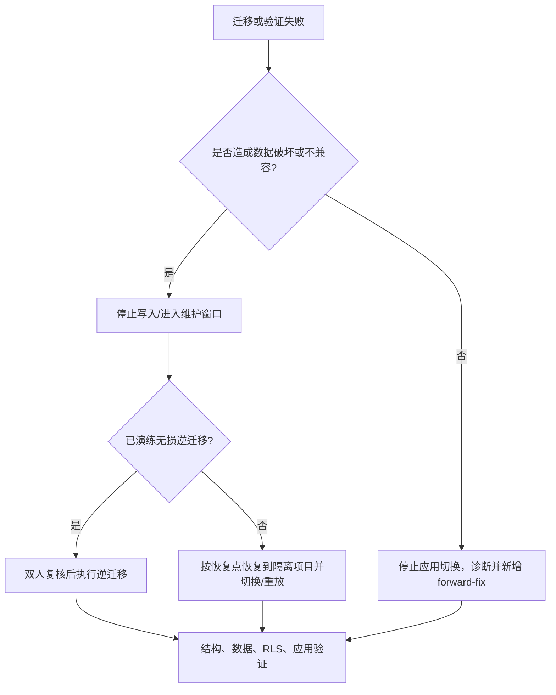

# 数据库发布与回滚

> **本文内容：** 规定 Supabase/PostgreSQL 迁移从编写、评审、备份、测试、发布、验证到失败处置和回滚的可执行流程。  
> **作用：** 降低误投项目、部分迁移、锁表、RLS 失效、应用与数据库不兼容及不可逆数据丢失的风险。  
> **何时更新：** 迁移工具、Supabase 项目、发布拓扑、CI/CD、备份能力、数据库所有者、回滚策略或 schema 约定变化时；每次重大数据库事故复盘后必须更新。

## 1. 当前能力与限制

当前事实：

- 权威迁移目录是 `supabase/migrations/`，现有 7 个 SQL 文件按文件名排序执行。
- 可执行脚本是 `scripts/db-push.mjs`：通过 Supabase Management API 逐文件提交 SQL，首个失败即退出。
- `.github/workflows/deploy.yml` **不执行数据库迁移**；push `main` 只构建/部署 Web 和 API。
- 仓库未提交 `supabase/config.toml`，没有标准本地 Supabase、seed、schema diff、迁移历史检查或自动 rollback。
- 脚本会重放所有文件，并有默认 Project Ref；没有已应用文件账本、dry-run 或跨文件事务。
- 当前 CI 没有数据库测试门禁，生产部署也没有 maintenance mode。
- 当前镜像只使用 `nalanda-api:latest`，部署后执行 image prune；没有可靠的不可变版本与一键应用回滚保证。

因此，数据库发布目前是**受控人工操作**。任何生产执行都必须由两人核对目标项目、具备发布前备份，并留下发布记录。

## 2. 基本原则

1. 已在任何共享环境执行的迁移永不编辑；修正必须新增时间戳迁移。
2. 默认采用 expand → migrate/backfill → switch application → contract，避免同一次发布中删除旧字段。
3. schema 变更和数据回填分开；大表回填要分批、可重入并有进度记录。
4. RLS、函数 EXECUTE、Storage policy 与表结构同等重要，必须一起评审和测试。
5. 数据库默认使用**向前修复**，不是盲目执行逆向 SQL。只有经过演练且确认不会丢数据时才做 schema rollback。
6. 生产迁移前必须明确恢复点；“SQL 看起来幂等”不等于可以无损回滚。
7. 绝不省略 `SUPABASE_PROJECT_REF`，绝不把生产 token 写入命令历史、仓库或 CI 日志。

## 3. 迁移文件约定

命名：

```text
supabase/migrations/<YYYYMMDDHHMMSS>_<short_snake_case_description>.sql
```

新迁移应包含：

- 文件头：目的、依赖、预计锁/耗时、兼容窗口；
- 明确的 `ALTER`/`CREATE`，不要只靠 `create table if not exists` 掩盖结构漂移；
- 新表的 RLS enable + 最小权限 policies；
- 新 `SECURITY DEFINER` 函数固定 `search_path`，显式 `REVOKE EXECUTE` 后只向必要角色授权；
- 约束、FK 删除语义和访问路径所需索引；
- 对数据回填给出可重入条件与核对查询；
- PR/发布记录中的 rollback/forward-fix 方案和不可逆点。

不要在同一个未经演练的文件中同时：重写大量数据、改约束、删旧列并改变 RLS。`CREATE INDEX CONCURRENTLY` 不能放在普通事务块内，应单独设计发布步骤并验证所用执行通道支持。

## 4. 发布前检查清单

### 4.1 代码与契约

- [ ] 新迁移文件名在现有文件之后，旧迁移无修改。
- [ ] [ERD](../guides/ERD.md)、[API 文档](../guides/API.md)及相关产品规则已同步。
- [ ] 老应用在新 schema 上仍能工作；新应用在 contract 前不会依赖已删除对象。
- [ ] 估算表规模、锁类型、执行时间与 statement timeout。
- [ ] 检查新增 FK/unique/check 对现有数据是否成立。
- [ ] 检查 RLS 的 SELECT/INSERT/UPDATE/DELETE 正反用例。
- [ ] 检查 service-role、authenticated、anon、函数 EXECUTE 和 Storage policy。
- [ ] 对触发器副作用、幂等和重放行为做专项测试。

### 4.2 环境与恢复点

- [ ] 先在一次性/隔离 Supabase 项目从空库应用全部迁移。
- [ ] 再在含生产规模近似数据的 staging 演练升级。
- [ ] 按[备份与恢复](./BACKUP_RECOVERY.md)创建发布前恢复点并验证可读。
- [ ] 记录生产 Project Ref 的前 4/后 4 位，由第二人核对控制台项目名和域名。
- [ ] 确认维护窗口、操作人、复核人、业务 owner 和停止条件。
- [ ] 准备验证 SQL、应用 smoke test、forward-fix SQL 和沟通渠道。

## 5. 非生产演练

从仓库根目录确认顺序：

```bash
find supabase/migrations -maxdepth 1 -type f -name '*.sql' -print | sort
```

在隔离开发项目执行：

```bash
SUPABASE_ACCESS_TOKEN=<personal-access-token> \
SUPABASE_PROJECT_REF=<disposable-project-ref> \
node scripts/db-push.mjs
```

随后**再次执行同一命令**，确认计划要求的可重放语句不会报错或重复制造业务副作用。注意：这只能验证当前 SQL 的重放表现，不能证明 schema 与预期一致。

最小结构检查：

```sql
select schemaname, tablename, rowsecurity
from pg_tables
where schemaname = 'public'
order by tablename;

select schemaname, tablename, policyname, cmd, roles
from pg_policies
where schemaname in ('public', 'storage')
order by schemaname, tablename, policyname;

select n.nspname as schema_name, p.proname, p.prosecdef as security_definer
from pg_proc p
join pg_namespace n on n.oid = p.pronamespace
where n.nspname = 'public'
order by p.proname;
```

还必须运行测试指南中的静态、数据库/RLS、API 与 E2E 分层测试；目前测试体系的实际命令见 [TESTING.md](../guides/TESTING.md)。

## 6. 生产发布步骤

### 6.1 冻结发布输入

记录：

```text
Git commit:
Migration files:
Production project ref (masked):
Operator / reviewer:
Backup or restore-point ID:
Start time / maintenance window:
Expected application version:
```

对当前脚本，建议使用受控 shell 会话临时注入变量；不要把值粘进仓库文件。执行前先让复核人确认命令中的 Ref。

### 6.2 执行 schema 扩展

```bash
SUPABASE_ACCESS_TOKEN=<production-access-token> \
SUPABASE_PROJECT_REF=<production-project-ref> \
node scripts/db-push.mjs
```

脚本会从第一个文件开始重放，成功日志格式为 `<filename>: ok`。保存文件名、开始/结束时间和退出码，但不要保存 token。

### 6.3 验证数据库

至少核对：

- 新表/列/索引/约束存在且类型正确；
- 预期 RLS 已启用，policy 命令与角色正确；
- 函数 owner、`security_definer`、`search_path`、EXECUTE grants 正确；
- 行数、NULL、唯一性、FK orphan、回填进度符合预期；
- 触发器只在预期事件触发，重复操作不产生额外账本/通知；
- Supabase Auth、PostgREST、Storage 没有异常率上升。

示例只读检查：

```sql
select to_regclass('public.profiles') as profiles,
       to_regclass('public.materials') as materials,
       to_regclass('public.posts') as posts,
       to_regclass('public.study_tasks') as study_tasks;

select conrelid::regclass as table_name, conname, pg_get_constraintdef(oid)
from pg_constraint
where connamespace = 'public'::regnamespace
order by conrelid::regclass::text, conname;
```

### 6.4 发布应用并做 smoke test

只有兼容性检查通过后才发布依赖新 schema 的应用。当前应用发布由 main workflow 完成，与数据库操作相互独立。验证：

```bash
curl -fsS https://nalanda.online/api/health
```

再使用隔离生产 smoke 账号验证登录、受保护查询和本次变更的最小业务路径。不要用个人真实数据测试，也不要让 smoke 数据长期留存。

### 6.5 结束发布

- 记录结束时间、验证结果、异常与处理；
- 观察至少一个预先约定窗口；
- contract/删除旧字段只在所有运行版本切换、观察期完成、备份可恢复后另开迁移；
- 更新变更日志/发布记录。

## 7. 失败处置决策



### 7.1 脚本中途失败

1. 不要立即重跑，也不要手工跳过失败文件。
2. 记录最后一个 `ok` 文件、失败文件、HTTP 状态和脱敏错误。
3. 在 SQL Editor/数据库中确认实际结构；跨文件不具备仓库级原子性。
4. 判断失败文件是否完全回滚、部分生效或已产生非事务副作用，不能只看脚本退出码推断。
5. 若旧应用仍兼容，保持旧应用运行，新增 forward-fix migration 并先在 staging 重现。
6. 若写入可能扩大损害，暂停相关入口后再处理。

### 7.2 应用发布失败、数据库成功

如果 schema 是向后兼容扩展，继续运行旧应用并修复应用。当前仓库没有可靠保留上一个镜像的机制；不要声称 `docker compose` 可以一键回到上一版本。目标是用 commit SHA 标记不可变镜像并记录前一稳定版本。

### 7.3 何时允许逆向 SQL

仅当全部满足：

- 在等价数据集演练过；
- 不删除上线后新增的有效数据；
- 锁表/耗时可控；
- 有刚创建且已验证的恢复点；
- 操作人和复核人确认 SQL 与目标项目；
- 逆迁移后旧应用契约成立。

`DROP TABLE`、`DROP COLUMN`、缩窄类型、撤销已写数据的约束变化通常不满足这些条件，应 forward-fix 或恢复备份。

## 8. Forward-fix 与恢复策略

优先顺序：

1. **停止切换**：保持旧应用，新增兼容修复迁移。
2. **功能降级**：关闭新写入口，保留读路径。
3. **应用回退**：仅在有已验证不可变 artifact 且新 schema 向后兼容时使用。
4. **数据库逆迁移**：仅用于已演练、无损的变更。
5. **恢复**：对数据破坏使用 Supabase 可用恢复点或经验证备份，先恢复到隔离项目验证，再决定切换。

完整恢复步骤见 [BACKUP_RECOVERY.md](./BACKUP_RECOVERY.md)。恢复后要重放恢复点之后经审计的业务事件；当前系统没有 points、credits、支付等不可变事件账本，因此无法保证自动重放，这正是后续模型必须补齐的能力。

## 9. 当前迁移的特别风险

- `profiles` owner update 可改 points/credits/VIP/等级/streak，数据库发布前应优先通过新迁移收紧。
- `_add_points`、`_notify` 等 `SECURITY DEFINER` 函数未显式撤销默认 EXECUTE，需审计 RPC 暴露。
- 积分触发器缺少事件账本和幂等键，关系删除/重建可能重复奖励。
- `study_goals.course_id` 的 RLS 未校验课程 owner。
- 表行删除与 Storage 对象删除无事务/级联，迁移或恢复会产生孤儿风险。
- 直接重放全部迁移没有迁移历史；目标是引入 Supabase CLI/等价工具、版本账本、schema diff、staging 和 CI gate。

## 10. 发布记录最低字段

每次数据库发布至少保存：

- ticket/PR、Git SHA、迁移文件及 checksum；
- 环境和脱敏 Project Ref；
- operator/reviewer、审批和时间窗口；
- 备份/恢复点 ID 与验证结果；
- 开始/结束/每文件状态；
- 结构、数据、RLS、API/E2E 验证结果；
- 是否回滚/forward-fix、事故链接和后续动作。

记录中不得包含 access token、数据库密码、service-role key 或用户 access token。
